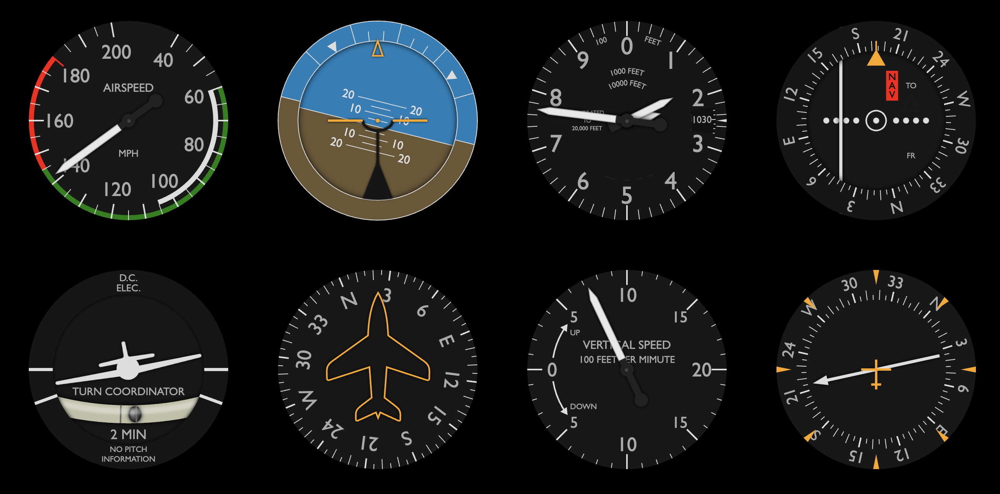
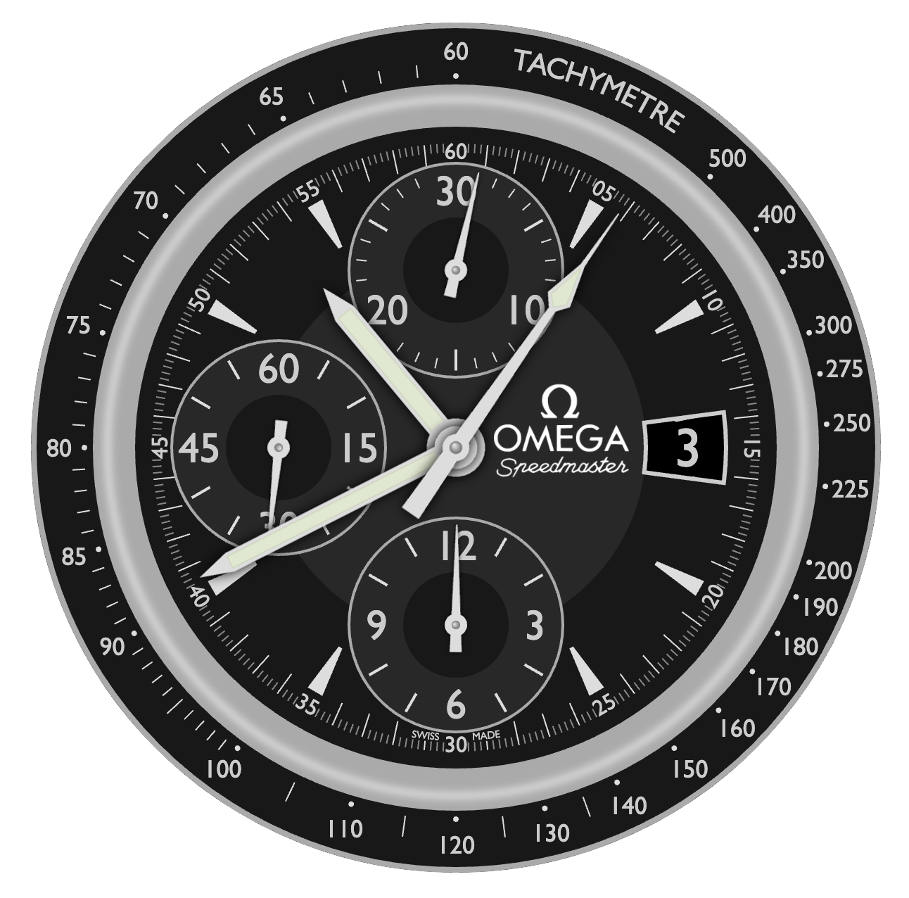

# G3: a flexible framework for steam gauge instrument panels

[G3](https://github.com/patricksurry/g3) is a flexible Javascript
framework for building steam gauge instrument panels
that display live external metrics from flight (or other) simulators
like [X-Plane](https://www.x-plane.com/)
and [Microsoft FS2020](https://www.flightsimulator.com/).
Here's a screenshot with some of the included flight gauges
(or try this [live demo](https://patricksurry.github.io/posts/g3-demo/)):

<div align='center'>
    
</div>

### TL;DR

- [Install G3](#installing)
- [Get started](#getting-started), then follow the [tutorial](doc/TUTORIAL.md) to build a panel or design a new gauge
- Browse the [Contributed Gauge Gallery](doc/CONTRIB.md), the [Cookbook](doc/COOKBOOK.md) of short recipes, and the complete [API reference](doc/API.md)
- Give back by [contributing](#contributing) new gauges and panels
- Explore related [resources](#resources)

**Keywords**: G3 D3 Javascript SVG flight simulator gauges instruments
control panel metrics telemetry dashboard visualization dataviz
XPlane FS2020

G3's goal is to provide a lightweight, browser-based solution
for building steam-gauge control panels using simple hardware atop a
commodity LCD display, powered by an affordable single-board computer
like the [Pi](https://www.raspberrypi.org/).
One of my original inspirations was this
[awesome Cessna setup](https://cessna172sim.allanglen.com/docs/instrument-panel/).
G3 could also be useful for interactive data visualizations and dashboards.

The name G3 is a tortured backronym for "generic gauge grammar"&mdash;and
has an [aircraft connection](https://en.wikipedia.org/wiki/Gulfstream_III)&mdash;but
was mainly chosen in homage to [D3](https://d3js.org/).
It's part of a quixotic pandemic project to build a
[DHC-2 Beaver](https://en.wikipedia.org/wiki/De_Havilland_Canada_DHC-2_Beaver) simpit.
Although there are plenty of [alternatives](#resources)
for creating instrument panels,
I decided it would be fun to roll my own based on pure Javascript with SVG using D3.
After several iterations, I ended up very close to
the pattern suggested by
[Mike Bostock](https://bost.ocks.org/mike/)
several years ago in
[Towards reusable charts](https://bost.ocks.org/mike/chart/).

The iconic [Omega Speedmaster](https://en.wikipedia.org/wiki/Omega_Speedmaster) watch,
mimicked by the example `omegaSpeedmaster` gauge below
(see [live demo](https://blocks.roadtolarissa.com/patricksurry/95f8f76a1dfd3c84e7a31429c7cbddc9)),
showcases G3's flexibility to create complex, working gauges that look good:

<div align='center'>
    
</div>


## Installing

You can skip installing altogether and just refer to a standalone copy of the
module distribution from an NPM CDN like these:

    https://unpkg.com/@patricksurry/g3/dist/g3-contrib.min.js

    https://cdn.jsdelivr.net/npm/@patricksurry/g3/dist/g3-contrib.min.js

You can also set up an [npm project](https://docs.npmjs.com/getting-started),
by creating a project directory and installing G3:

    npm install @patricksurry/g3

If you prefer a local standalone copy, you can download any of `g3[-contrib][.min].js`
directly from [unpkg](https://unpkg.com/browse/@patricksurry/g3/dist/) or
[jsDelivr](https://cdn.jsdelivr.net/npm/@patricksurry/g3/dist/) (right-click and "Save As").
The base `g3` package provides the API to define gauges and assemble them into control panels,
and the `g3-contrib` package adds a bunch of predefined gauges and panels
that you can use or modify.   The `.min` versions are minified to load slightly faster,
but harder to debug.  Choosing `g3-contrib.js` is probably a good start.
See [Contributing](#contributing) if you want to hack on G3.

## Getting started

Check things are working by creating a minimal HTML file called `gallery.html`
that shows all the contributed gauges, animated with fake metrics:

```html
<html>
    <body>
        <script src="https://unpkg.com/@patricksurry/g3/dist/g3-contrib.min.js"></script>
        <script>
g3.gallery.contrib('body');
        </script>
    </body>
</html>
```

Serve it locally with something like `python -m http.server`
and browse to http://localhost:8000/gallery.html.

Then follow the [tutorial](doc/TUTORIAL.md) to
[build your own panel](doc/TUTORIAL.md#define-your-own-panel-with-existing-gauges),
[display real metrics](doc/TUTORIAL.md#display-real-metrics) from a simulator,
and [design a new gauge](doc/TUTORIAL.md#create-a-new-gauge).
The [cookbook](doc/COOKBOOK.md) has short recipes for common problems.

## Contributing

If you want to extend G3, improve the documentation,
or just add your own examples back into the package,
you should start by forking and cloning the
[git repo](https://github.com/patricksurry/g3.git)
followed by `npm install`.
Check the [issue tracker](https://github.com/patricksurry/g3/issues)
if you're looking for something to play with.

Check the unit tests after any changes with `npm run test`.
The same type check, lint, tests and build run in CI on every pull request (see `.github/workflows/ci.yml`).
Ensure new code is tested using `npm test -- --coverage`.
The test suite also verifies that every contributed gauge has a JSDoc description,
matches its deterministic SVG snapshot in `tests/contrib/*.svg`, and is documented in `doc/CONTRIB.md`.
After adding or modifying a contributed gauge in `src/contrib/`, run `npm run docs`
to regenerate the SVG snapshots and `doc/CONTRIB.md`.

You can test changes interactively by serving directly from the `src/` tree using
[Vite](https://vite.dev/).
Use `npm run start` to launch the gauge gallery panel from `src/index.html`
in your browser.
(Note this HTML script uses module style imports unlike the production distribution.)

You can build the bundled package and TypeScript declarations into `dist/` by typing `npm run build`
(`dist/` is git-ignored and built automatically on `npm publish` via the `prepack` script).
Once you're happy with your changes, make a pull request.
When I want to publish a new release, I also bump the version in `package.json`,
then merge and tag in github and finally publish with something like:

```sh
git tag v0.1.20
git push origin --tags
npm login
npm publish --access public
```


## Resources

- [Towards reusable charts](https://bost.ocks.org/mike/chart/)
- [Python SimConnect](https://github.com/odwdinc/Python-SimConnect) Python interface for MS FS2020 using SimConnect
- [Sim Innovations](https://siminnovations.com/) create instrument panels with Air Manager
- [Home cockpit simulator control interface](https://hcscis.com/) combine physical instruments and panels
- [MobiFlight](https://www.mobiflight.com) open source project integrating hardware with your flight sim

## API

See [doc/API.md](doc/API.md), and [doc/COOKBOOK.md](doc/COOKBOOK.md) for short recipes.
