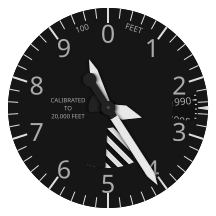
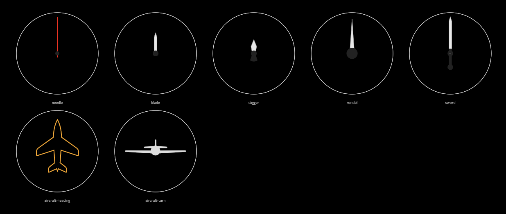

## API reference

### Key concepts

A [panel](#panel) is a container that presents a collection of [gauges](#gauge),
and orchestrates the display of [metrics](#metrics),
normally provided by an external [hub](#hubs) such as a simulator bridge.
A panel is a client of its hub: gauges read metrics from it,
and interactive controls send [actions](#actions) back to it.
Without an external hub, the panel runs a [local hub](#local-hub)
which generates [fake time-varying metrics](#fake-metrics) for development purposes.
A simple gauge displays some metric,
using a scale to transform the raw metric
and [indicate](#indicate) that value on a local [axis](#axis),
usually adorned with [ticks](#axis), [labels](#axis) and other SVG [decorations](#svg-elements).
Typical "steam gauges" use a circular coordinate system to indicate
metric values using a rotating [pointer](#indicate).
More complex gauges might display the same metric at several scales
(e.g. a clock with a second, minute and hour hand,
or an altimeter displaying hundreds, thousands and ten-thousands of feet);
contain one or more sub-gauges that display different metrics
(like a combined oil and fuel temperature gauge);
or indicate values using [text](#indicate) (such as a digital watch or radio frequency LCD)
or SVG [style](#indicate) such as color rather than a pointer.
Some gauges *auto-indicate*, in that the gauge itself
tracks the metric value with respect to a fixed point,
for example the pressure reading of an altimeter
or the "day of month" of some watches
where the gauge axis rotates to be visible through a fixed window.

<p align='center'></p>

In order to keep things modular, and separate gauge configuration
from usage in a specific panel,
G3 uses the pattern of closures with getter-setter methods
from Mike Bostock's approach to [reusable charts](https://bost.ocks.org/mike/chart/).
This means that most G3 components return a configurable drawing function
which is ultimately rendered to SVG by calling it with a [D3 selection](https://github.com/d3/d3-selection)
or CSS selector string.
The typical drawing function looks like this:
```js
(selection, gauge) => {
  /* append component instance to selection, perhaps based on parent gauge properties */
}
```
[Gauge components](#gauge) register interest
in their gauge's metrics so that the containing [panel](#panel) can redraw them when any of those metrics change.
Data flows one way: the hub owns metric state, gauges only ever draw what the hub reports,
and controls change state by sending actions to the hub rather than by updating the display directly.


### Gauge

A [*gauge()*](#g3-gauge) is the core component of G3,
typically containing a number of components to indicate one or more metrics.
Gauges are often decorated with a [*gaugeFace()*](#g3-gaugeFace),
[*gaugeLabel()s*](#g3-gaugeLabel) and [*gaugeScrew()s*](#g3-gaugeScrew).


<a id="g3-gauge" href="#g3-gauge">#</a>
g3.**gauge**() · [source](/src/gauge.ts)

Creates a gauge renderer configured via the
*gauge* getter/setter methods described below, e.g. *gauge*.r(100).
The *gauge* is called to draw it within an SVG document, e.g. *gauge*(d3.select('svg.mygauge')).
Typically *gauge* is not drawn directly
but instead appended to a [panel](#panel) which will draw it and manage metric updates.
A *gauge* is also [stylable](#stylable) and [appendable](#appendable) via [mixins](#mixins).
A number of pre-configured gauge builders are available via the functions in `g3.contrib.*`; see the [Contributed Gauge Gallery](CONTRIB.md) for the complete catalog.

<a id="g3-gauge-metric" href="#g3-gauge-metric">#</a>
*gauge*.**metric**(\[*metric*: string\[, ...*others*: string\]\]) · [source](/src/gauge.ts)

If *metric* is specified, set the name of the metric that this gauge will indicate.
If *metric* is not specified, return the name of the current metric, defaulting to *undefined*.
The name is a [metric key](#metric-keys), which may be more specific than the metric the hub actually provides.

Any *others* name secondary metrics that the gauge also depends on.
The gauge's components redraw whenever *metric* **or** any of *others* changes.
Each redraw passes the (unit-converted) value of *metric* as `v`,
along with the latest value of every metric as `metrics`,
so callbacks like *trigger*, *format* and *rescale* can combine them, e.g.
```js
g3.gauge().metric('transponderCode', 'transponderMode').append(
    g3.indicateText().format((v, metrics) => metrics.transponderMode == 'TST' ? '8888' : v)
)
```
Values in `metrics` are as reported by the hub, without unit conversion.
*gauge*.**metrics**() returns the full list `[metric, ...others]`.

*gauge*.**unit**(\[*unit*: string\]) · [source](/src/gauge.ts)

If *unit* is specified, set the unit of measurement for the current metric,
otherwise return the current unit, defaulting to *undefined*.
G3 will convert input data to the target unit,
provided that both the gauge and external metric source define explicit units,
and those units are known and compatible in the
[convert-units](https://github.com/convert-units/convert-units) module.
For example, a gauge designed to show miles/hour (mph)
could then correctly display speeds provided in km/hour (kph).

<a id="g3-gauge-fake" href="#g3-gauge-fake">#</a>
*gauge*.**fake**(\[*generator*: function | any\]) · [source](/src/gauge.ts)

If *generator* is specified, it defines how the [local hub](#local-hub) produces values for this gauge's metric
when a panel has no external hub.
A function is called once per panel interval as *generator*(*current*), where *current* is the metric's current
value in the local hub, and returns the next value.
Generators that track their own state can ignore *current*,
but the built-in generators continue from it, so a metric that is changed by an [action](#actions)
carries on varying from its new value.
Any other value is a constant initial value, which is appropriate for inputs like switches
that only change in response to actions, e.g. *gauge*.fake(0).
If *generator* is not specified, the current generator is returned.
See [fake metrics](#fake-metrics) for available generators.

<a id="g3-gauge-send" href="#g3-gauge-send">#</a>
*gauge*.**send**(*action*: object\[, ...*actions*: object\]) · [source](/src/gauge.ts)

Sends one or more [actions](#actions) to the panel's hub, in order.
This is how interactive controls change state, typically from a DOM event handler registered with `.on()`.
Actions that name a metric default to this gauge's primary *metric*,
and are expressed in this gauge's *unit* if it has one, e.g.
```js
g.send({op: 'adjust', by: 5})               // nudge g.metric() by 5 g.unit()s
g.send({op: 'set', value: 1})               // set g.metric() to 1
g.send({op: 'trigger', event: 'transponderIdent'})
```
Sending an action never updates the display directly;
the gauge redraws when the hub reports the resulting change.

*gauge*.**kind**(\[*kind*: string\]) · [source](/src/gauge.ts)

If *kind* is specified, it must be one of the strings `circular`, `linear`, `longitude` or `latitude`
to select how the axis is displayed for this gauge.
If *kind* is not specified, return the current value, defaulting to `circular`.

The `longitude` and `latitude` kinds draw on the surface of a ball,
seen in [orthographic projection](https://d3js.org/d3-geo/azimuthal#geoOrthographic) with radius *gauge*.r(),
for instruments like an attitude ball or a wet compass.
The *measure* maps metric values to degrees of longitude or latitude respectively.
Axis [ticks](#g3-axisTicks), [labels](#g3-axisLabels), [sectors](#g3-axisSector) and [lines](#g3-axisLine)
are drawn tangent to the surface, so they foreshorten as the ball turns, and are hidden on its far side.
Their *inset* and *size* are measured in SVG units along the surface at the centre of the ball
(an arc of *d* degrees spans *d*·π/180·*r* units):
on a `longitude` gauge, inset runs south from the equator, like ticks running inward on a circular gauge;
on a `latitude` gauge, inset runs east from the prime meridian, with the axis pointing north,
like a linear gauge rotated by -90°.
A spherical gauge nested inside another shares its ball,
so for example a `latitude` gauge for pitch inside a `longitude` gauge for heading turns one ball by both.
Roll is an ordinary circular [autoindicate](#g3-gauge-autoindicate) wrapped around the ball.
Pointers are not supported on spherical gauges.
See `g3.contrib.nav.attitude.ball` and `g3.contrib.nav.compass.wet` in the [gallery](CONTRIB.md).

*gauge*.**measure**(\[*measure*: any &rArr; number\]) · [source](/src/gauge.ts)

If *measure* is specified, it defines a [d3.scale](https://github.com/d3/d3-scale)-like
function which transforms metric values to the axis coordinate system of the gauge,
and provides *measure*.domain() and *measure*.range() accessors reporting the expected
range of the source metric and axis coordinates respectively.
For example, on a gauge with a circular axis,
*gauge*.measure(d3.scaleLinear().domain(\[0,10\]).range(\[-90, 90\]))
would map a metric expected to take values between 0 and 10
to a semi-circular axis on the top half of the gauge face
(i.e. between -90° and 90°).

*gauge*.**rescale**(\[*rescale*: any &rArr; any\]) · [source](/src/gauge.ts)

If *rescale* is defined, specifies a function that
rescales the current metric value before applying the *measure()* scale,
thus changing the domain of the metric before it's transformed to the gauge axis range.
Otherwise, returns the current rescaling, which defaults to the identity function.
For example, a dateTime metric might be rescaled to the day-of-month domain
before displaying on a calendar wheel.

*gauge*.**r**(\[*radius*: number\]) · [source](/src/gauge.ts)

If *radius* is specified it defines the size of the gauge in SVG units,
otherwise the current *radius* is returned, defaulting to 100.
For circular gauges, the axis line will be placed here.

<a id="g3-gauge-autoindicate"></a>
*gauge*.**autoindicate**(\[*flag*: bool\]) · [source](/src/gauge.ts)

If *flag* is set, the boolean value defines whether this gauge should self-indicate,
otherwise return the current value, defaulting to false.
Most gauges are fixed and use a pointer, text or style to indicate the current metric value.
A self-indicating gauge transforms itself so that the axis location corresponding
to the current metric value stays at a fixed position.
A circular gauge rotates so the correct axis value is shown at the top,
a linear gauge slides itself to the correct axis value is shown centered at *x*=0,
and a spherical gauge turns its ball so the correct value faces the viewer.
To change the position where the gauge indicates, apply a transformation.
For example, to indicate in a window at the 3 o'clock position, try:

    g3.put().rotate(90).append(g3.gauge().autoindicate(true)...)

*gauge*.**clip**(\[*clippath*: function\]) · [source](/src/gauge.ts)

If *clippath* is set, it defines a G3 drawing function that, when called, draws a clipping path for this gauge.
Otherwise, it returns the current drawing function, defaulting to undefined.
For complex nested gauges, like the attitude indicator, it is sometimes convenient to clip to a simple circle
via *gauge*.clip(g3.gaugeFace()).

*gauge*.**grid**(\[*show*: boolean\]) · [source](/src/gauge.ts)

If *show* is defined, update the value.
Otherwise returns the current value, which defaults to `false`.
If *show* is true, a background grid will be displayed 
on the gauge using `g3.grid()`.  
This can be useful during layout development.


<a id="g3-gaugeFace" href="#g3-gaugeFace">#</a>
g3.**gaugeFace**() · [source](/src/gauge.ts)

Returns a [stylable](#stylable) *gaugeFace* object, which when called will draw a circle with CSS class `g3-gauge-face`.

*gaugeFace*.**r**(\[*r*: number\]) · [source](/src/gauge.ts)

If *r* is defined, set the radius for the circular face, otherwise return the current value, defaulting to 100.

*gaugeFace*.**window**(\[*window*: object\]) · [source](/src/gauge.ts)

If *window* is defined, use that drawing function to define an
[SVG mask](https://developer.mozilla.org/en-US/docs/Web/SVG/Element/mask)
on the gauge face to "cut out" a window.  Otherwise, return the current window defaulting to undefined.


<a id="g3-gaugeLabel" href="#g3-gaugeLabel">#</a>
g3.**gaugeLabel**(\[*value*: string\[, *opts*: object\]\]) · [source](/src/gauge.ts)

Create a [stylable](#stylable) *gaugeLabel* function which adds SVG text to a gauge when called.
If *value* is set, it defines the initial value of the label.
The optional *opts* can be used as a shortcut for the accessor functions.
For example `g3.gaugeLabel("hello", {x: 20, y: 20})`
is equivalent to `g3.gaugeLabel().value("hello").x(20).y(20)`.

*gaugeLabel*.**value**(\[*value*: string\]) · [source](/src/gauge.ts)

Set the label text to *value* if defined, otherwise return the current value.

*gaugeLabel*.**size**(\[*size*: number\]) · [source](/src/gauge.ts)

Set the label size to *size* SVG units, otherwise return the current value which defaults to 10.

*gaugeLabel*.**x**(\[*x*: number\]) · [source](/src/gauge.ts)

*gaugeLabel*.**y**(\[*y*: number\]) · [source](/src/gauge.ts)

*gaugeLabel*.**dx**(\[*dx*: number\]) · [source](/src/gauge.ts)

*gaugeLabel*.**dy**(\[*dy*: number\]) · [source](/src/gauge.ts)

Set or return the *x*, *y*, *dx* or *dy* values of the underlying
[SVG text element](https://developer.mozilla.org/en-US/docs/Web/SVG/Element/text)
respectively.


<a id="g3-gaugeScrew" href="#g3-gaugeScrew">#</a>
g3.**gaugeScrew**() · [source](/src/gauge.ts)

A *gaugeScrew* configures a [stylable](#stylable), [transformable](#transformable) screw head.
When called, draws the screw with the selected head shape oriented in a random rotation.

*gaugeScrew*.**r**(\[*r*: number\]) · [source](/src/gauge.ts)

If *r* is defined, set the radius of the screw head, otherwise return the current value, defaulting to 8.

*gaugeScrew*.**shape**(\[*shape*: string\]) · [source](/src/gauge.ts)

If *shape* is defined, sets the screw head style to one of `slotted`, `phillips` or `robertson`.
Otherwise returns the current shape, defaulting to `slotted`.


### Axis

The gauge axis represents the metric on the gauge face,
with the gauge measure mapping from the metric domain
to the range of coordinates of the gauge itself.
An [*axisLine()*](#g3-axisLine) draws a line covering the domain of the metric,
usually including [*axisTicks()*](#g3-axisTicks) to draw tick marks,
and [*axisLabels()*](#g3-axisLabels) to add labels.
Sometimes [*axisSector()s*](#g3-axisSector) 
are used to highlight particular regions of the axis,
and can also be used for windows, rings or other annular decorations.


<a id="g3-axisLine" href="#g3-axisLine">#</a>
g3.**axisLine**() · [source](/src/axis.ts)

Returns a [stylable](#stylable) *axisLine*, which draws a line spanning the domain of its parent gauge's metric.
Essentially a shortcut for g3.axisSector(\[*min, max*\]).size(0).inset(0).class('g3-axis-line')
where \[*min, max*\] are the smallest and largest values of this gauge's metric.


<a id="g3-axisTicks" href="#g3-axisTicks">#</a>
g3.**axisTicks**(\[*vs*: array<number>\]) · [source](/src/axis.ts)

Returns a [stylable](#stylable) *axisTicks* object, which will draw tick marks along the axis line.
The optional *vs* defines a list of specific tick mark locations in the metric domain.

*axisTicks*.**values**(\[*vs*: array<number>\]) · [source](/src/axis.ts)

If *vs* is defined, set specific tick mark locations along the axis, in the metric domain.
Otherwise return the current list of locations, which defaults to none.
See also *axisTicks*.start() and  *axisTicks*.step()

*axisTicks*.**step**(\[*step*: number\]) · [source](/src/axis.ts)

If *step* is defined, set the step size for tick marks in the metric domain.
Otherwise return the current value, which defaults to 1.
See also  *axisTicks*.start().

*axisTicks*.**start**(\[*start*: number\]) · [source](/src/axis.ts)

If *start* is defined, set the first tick mark location in the metric domain.
Otherwise return the current value, which defaults to *gauge*.metric().domain()\[0\].

*axisTicks*.**shape**(\[*shape*: string\]) · [source](/src/axis.ts)

If *shape* is defined, sets the current tick mark shape to one of 
`tick`, `dot`, `wedge` or `rect`.
Otherwise, return the current shape, which defaults to `tick`.

*axisTicks*.**size**(\[*size*: number\]) · [source](/src/axis.ts)

If *size* is defined, set the current tick mark size, otherwise return the current value,
which defaults to 10.
The *size* is measured inward from the axis line,
use a negative value (or negative inset) for outward ticks
on a circular gauge.

*axisTicks*.**width**(\[*width*: number\]) · [source](/src/axis.ts)

If *width* is defined, set the current tick mark width along the axis, in SVG units.
Otherwise return the current value, which defaults to 1.
The `wedge` and `rect` shapes support *width*.

*axisTicks*.**inset**(\[*inset*: number\]) · [source](/src/axis.ts)

If *inset* is defined, set the current tick mark inset inside the axis line.
Otherwise, return the default value, which defaults to 0.


<a id="g3-axisLabels" href="#g3-axisLabels">#</a>
g3.**axisLabels**(\[*vs*: array<number>|object\]) · [source](/src/axis.ts)

Returns a [stylable](#stylable) *axisLabels* object,
which will draw text labels relative to the gauge's metric domain.

If *vs* is defined, set specific label locations along the axis, in the metric domain.
If *vs* is an array of numbers, each value defines a label position
with a text label produced by *axisLabels*.format().
If *vs* is an object, each key is interpreted as a number with the
value giving the text label.
For example
*axisLabels*.values(\[0, 5, 10\]) or
*axisLabels*.values({0: "empty", 10: "full"}).
Otherwise return the current list of label locations, which defaults to none.
See also *axisLabels*.start() and  *axisLabels*.step()

*axisLabels*.**step**(\[*step*: number\]) · [source](/src/axis.ts)

If *step* is defined, set the step size for labels in the metric domain.
Otherwise return the current value, which defaults to 1.
See also  *axisLabels*.start().

*axisLabels*.**start**(\[*start*: number\]) · [source](/src/axis.ts)

If *start* is defined, set the first label location in the metric domain.
Otherwise return the current value, which defaults to *gauge*.metric().domain()\[0\].

*axisLabels*.**format**(\[*format*: number &rArr; string\]) · [source](/src/axis.ts)

If *format* is defined, it is assumed to be a function that converts a
metric value indicating a label position to the appropriate text label.
For example *axisLabels*.format(v &rArr; Math.round(v/100)) might be used
to label a gauge in hundreds.

*axisLabels*.**size**(\[*size*: number\]) · [source](/src/axis.ts)

If *size* is defined, set the text size in SVG units.
Otherwise return the current size, which defaults to 20.

*axisLabels*.**inset**(\[*inset*: number\]) · [source](/src/axis.ts)

If *inset* is defined, set the current tick mark inset inside the axis line.
Otherwise, return the default value, which defaults to 0.

*axisLabels*.**orient**(\[*orient*: string\]) · [source](/src/axis.ts)

If *orient* is defined, it indicates one of the label orientations
`fixed`, `relative`, `upward`, `clockwise`, or `counterclockwise`.
Otherwise it returns the current orientation which defaults to `fixed`.
In `fixed` orientation, labels ignore the local direction of the axis,
i.e. on a circular gauge with all labels would appear as unrotated text.
In `relative` orientation, labels are tangent
to the axis at their position,
i.e. on a circular gauge all labels would read along the circle.
Note that *axisLabels*.rotate() applies
after this basic orientation.
In `upward` orientation, labels behave like `relative`
but an additional 180° rotation is added if the
label would otherwise point downward in the labels' container.
In `clockwise` or `counterclockwise` orientation,
text is laid out along the axis path
centered on the label location, so that on a circular gauge
labels wrap around the circle,
reading in the described direction.
Additional rotation does not apply in this case.

*axisLabels*.**rotate**(\[*rotate*: number\]) · [source](/src/axis.ts)

If *rotate* is defined, set the current rotation angle in degrees.
Otherwise return the current rotation, which defaults to 0.
See also *orient*.


<a id="g3-axisSector" href="#g3-axisSector">#</a>
g3.**axisSector**(\[*vs*: array<number>\]) · [source](/src/axis.ts)

Returns a [stylable](#stylable) *axisSector* object, which draws part of an
[annulus](https://en.wikipedia.org/wiki/Annulus_(mathematics)) relative to the gauge's axis line.
If *vs* is defined it must be a two element array
giving the starting and ending point for the sector
in the domain of the gauge measure,
otherwise the sector spans the full domain.
This is typically used to highlight important regions of the axis,
and can also be used to add windows, rings or other annular decorations.

*axisSector*.**size**(\[*size*: number\]) · [source](/src/axis.ts)

If *size* is defined, sets the width of the sector in SVG units, otherwise returning the current value,
which defaults to 5.  Size is measured inward from the axis line.

*axisSector*.**inset**(\[*inset*: number\]) · [source](/src/axis.ts)

If *inset* is defined, sets the distance inside the axis line the outer rim of the sector.
Otherwise returns the current value, which defaults to 0.
Use a negative value for sectors outside the axis line.


### Indicate

Gauges are only useful when they *indicate* one or more metrics.
Some gauges [self indicate](#g3-gauge-autoindicate) but most
use a [pointer](#g3-indicatePointer), [text](#g3-indicateText),
or [style](#g3-indicateStyle) to display the current metric value.
You can create fairly compelling segmented LCD displays using
[DSEG](https://www.keshikan.net/fonts-e.html) fonts,
declared by G3 as the `DSEG7-Classic` and `DSEG14-Classic` font-family.


<a id="g3-indicateText" href="#g3-indicateText">#</a>
g3.**indicateText**() · [source](/src/indicate.ts)

Returns a [stylable](#stylable) *indicateText* object,
which is called to update the current metric value as text,
with optional formatting.
Use [g3-put()](#g3-put) to control the positioning of the text.


*indicateText*.**format**(\[*format*: (value, metrics, unit) &rArr; string\]) · [source](/src/indicate.ts)

If *format* is defined, it specifies a function that converts metric values to text
(receiving the current metric *value*, the dictionary of all current *metrics*, and the resolved *unit*).
Otherwise returns the current formatter, which defaults to the identity function.
For example, *indicateText*.format(v &rArr; Math.round(v/100)) would display the
metric value in hundreds.

*indicateText*.**size**(\[*size*: number\]) · [source](/src/indicate.ts)

If *size* is defined, specifies the size of the text in SVG units,
otherwise returns the current size, defaulting to 20.


<a id="g3-indicateUnit" href="#g3-indicateUnit">#</a>
g3.**indicateUnit**() · [source](/src/indicate.ts)

Returns a [stylable](#stylable) *indicateUnit* object,
which is called to display the current metric's unit (either configured on the parent gauge via *gauge*.unit() or provided dynamically in the source `units` data) as text,
with optional formatting.

*indicateUnit*.**format**(\[*format*: (unit, value, metrics) &rArr; string\]) · [source](/src/indicate.ts)

If *format* is defined, it specifies a function that formats the unit string into display text
(receiving the resolved *unit*, the current metric *value*, and the dictionary of all current *metrics*).
Otherwise returns the current formatter, which defaults to the identity function.

*indicateUnit*.**size**(\[*size*: number\]) · [source](/src/indicate.ts)

If *size* is defined, specifies the size of the text in SVG units,
otherwise returns the current size, defaulting to 20.


<a id="g3-indicatePointer" href="#g3-indicatePointer">#</a>
g3.**indicatePointer**() · [source](/src/indicate.ts)

Returns a [stylable](#stylable), [appendable](#appendable) *indicatePointer* object,
which is called to draw a pointer that typically points to the current metric value,
or some converted version, on the gauge axis.
A standard pointer can be configured using *indicatePointer*.shape(),
or the pointer can be customized with arbitrary elements via *indicatePointer*.append().

*indicatePointer*.**shape**(\[*shape*: string\]) · [source](/src/indicate.ts)

If *shape* is defined, selects a pointer shape from the enumeration in [pointers.ts](/src/pointers.ts).
The shapes currently available are illustrated below.
Otherwise, returns the current pointer shape, defaulting to `needle`.

<div align='center'>
    
</div>
<br />

*indicatePointer*.**rescale**(\[*rescale*: any &rArr; any\]) · [source](/src/indicate.ts)

If *rescale* is defined, specifies a function that
rescales the current metric value before indicating.
This scaling happens before the *measure()* is applied,
effectively modifying the domain of the metric before it's transformed to the gauge axis range.
Otherwise, return the current conversion, which defaults to the identity function.
For example, an altimeter might indicate in hundreds, thousands and ten-thousands
using pointers with different scales.

*indicatePointer*.**clamp**(\[*extents*: array<number>\]) · [source](/src/indicate.ts)

If *extents* is defined, it provides a two-element array defining
the minimum and maximum extent of the pointer domain, after any rescaling.
For one-sided clamping, pass null or undefined as one of the values.
Otherwise, return the current limits which default to \[undefined, undefined\].
For example, the vertical speed indicator shouldn't wrap around if the speed exceeds
the axis scale, so would typically be clamped slightly within the maximum extent of the axis.
A similar effect could be achieved by enabling
[clamping](https://github.com/d3/d3-scale#continuous_clamp) on the gauge's measure,
but this would also prevent any axis decorations beyond the clamped extent.

<a id="g3-indicateSector" href="#g3-indicateSector">#</a>
g3.**indicateSector**() · [source](/src/indicate.ts)

Returns a [stylable](#stylable) *indicateSector* object,
which is called to draw a sector on the gauge axis representing the range
between a fixed anchor point and the current metric value.
This is useful for things like turn coordinators or deviation indicators.

*indicateSector*.**anchor**(\[*anchor*: number\]) · [source](/src/indicate.ts)

If *anchor* is defined, sets the fixed anchor value in the metric domain.
Otherwise returns the current anchor, defaulting to 0.
The sector will be drawn from this value to the current metric value.
If the current value is less than the anchor, the sector is drawn "backwards"
and the class `g3-indicate-sector-negative` is added, allowing for different styling.

*indicateSector*.**size**(\[*size*: number\]) · [source](/src/indicate.ts)

If *size* is defined, sets the width of the sector in SVG units.
Otherwise returns the current value,
which defaults to 10. Size is measured inward from the axis line.

*indicateSector*.**inset**(\[*inset*: number\]) · [source](/src/indicate.ts)

If *inset* is defined, sets the distance of the outer rim of the sector inside 
the axis line (outside, if negative).
Otherwise returns the current value, which defaults to 0.

*indicateSector*.**rescale**(\[*rescale*: any &rArr; any\]) · [source](/src/indicate.ts)

If *rescale* is defined, specifies a function that
rescales the current metric value before indicating.
Otherwise, returns the current conversion, which defaults to the identity function.

*indicateSector*.**clamp**(\[*extents*: array<number>\]) · [source](/src/indicate.ts)

If *extents* is defined, it provides a two-element array defining
the minimum and maximum extent of the sector domain, after any rescaling.
Otherwise, return the current limits which default to \[undefined, undefined\].


<a id="g3-indicateStyle" href="#g3-indicateStyle">#</a>
g3.**indicateStyle**() · [source](/src/indicate.ts)

Returns an [appendable](#appendable) *indicateStyle* object,
which is called to apply CSS styling conditional on the current metric.
A trigger function chooses between "on" or "off" styling.
The default style shows or hides the *indicateStyle* contents
depending on whether the metric is non-zero.
See also [statusLight](#g3-statusLight) which provides
a convenience wrapper for indicator lights.

*indicateStyle*.**trigger**(\[*trigger*: (value, metrics, unit) &rArr; float\]) · [source](/src/indicate.ts)

If *trigger* is defined, specifies a function
mapping the current metric value (along with the dictionary of all current *metrics* and resolved *unit*) to a
proportion between 0 and 1
which tweens between the off (0) and on (1) style.
Otherwise, returns the current trigger function, which defaults to the identity
(meaning that the style is on whenever the metric is non-zero).

*indicateStyle*.**styleOn**(\[*styleOn*: object\]) · [source](/src/indicate.ts)

If *styleOn* is defined, it specifies a dictionary of styles to apply
to the *indicateStyle* contents when the *trigger* is true.
Otherwise, returns the current styles, which default to `{opacity: 1}`.

*indicateStyle*.**styleOff**(\[*styleOff*: object\]) · [source](/src/indicate.ts)

If *styleOff* is defined, it specifies a dictionary of styles to apply
to the *indicateStyle* contents when the *trigger* is false.
Otherwise, returns the current styles, which default to `{opacity: 0}`.


<a id="g3-snapScale" href="#g3-snapScale">#</a>
g3.**snapScale**() · [source](/src/common.ts)

Creates a *snapScale* object which provides a continuous
"staircase" transformation function that pulls its input value
towards the closest step value.
This is useful to create pointers that "tick" like the second hand of a clock,
and can be provided as an argument to rescale an [indicator](#indicate).
When called, the closest step to the input value is determined, and the
output is transformed according to a D3 [power scale](https://github.com/d3/d3-scale#power-scales):

    d3.scalePow().domain([-w,w]).range([-w,w]).exponent(strength)

where *w* is half the step size, and *strength* determines how strong the pull is.

TODO: probably better to define the percent of the original for 'half-life' of the transformed step,
e.g. for calendar wheel it should 'tick' over a second or so once per day.
Or maybe this is scale should just be deprecated entirely:
another way to get a similar effect is to specify (or rescale) the metric as integer values,
so we'd get a single refresh transform with duration equal to polling interval.

*snapScale*.**start**(\[*start*: number\]) · [source](/src/common.ts)

If defined, *start* sets the starting anchor point for calculating steps,
otherwise returns the current value defaulting to 0.

*snapScale*.**step**(\[*step*: number\]) · [source](/src/common.ts)

If defined, *step* sets the step size,
otherwise returns the current value defaulting to 1.

*snapScale*.**strength**(\[*strength*: number\]) · [source](/src/common.ts)

If defined, *strength* sets the strength of pull towards each step location,
otherwise returns the current value defaulting to 5.
A value of 1 results in a linear scale, i.e. with no pull,
and positive values less than 1 result in repulsion away from step locations.


<a id="g3-statusLight" href="#g3-statusLight">#</a>
g3.**statusLight**() · [source](/src/gauge.ts)

A convenience wrapper for [indicateStyle](#g3-indicateStyle)
that creates a gauge whose face lights up when its metric meets a trigger threshold.
Roughly equivalent to:

    g3.gauge().metric(metric).append(
        g3.indicateStyle().trigger(trigger).append(
            gaugeFace().style(`fill: ${color}`),
            gaugeFace().class('g3-highlight'),
        )
    )

*statusLight*.**metric**(\[*metric*: string\]) · [source](/src/gauge.ts)

Set or return the [gauge](#g3-gauge)'s metric.

*statusLight*.**trigger**(\[*trigger*: any &rArr; boolean\]) · [source](/src/gauge.ts)

Set or return the trigger function for the [indicateStyle](#g3-indicateStyle).

*statusLight*.**color**(\[*color*: string\]) · [source](/src/gauge.ts)

If *color* is defined, sets the color to display when the trigger is on.
Otherwise return the current color, which defaults to `red`.


### Panel

A [*panel()*](#g3-panel) is a container for gauges,
which is used to manage layout and coordinate the update of metrics.
The panel connects to a [hub](#hubs), either an external one at *url*
or a [local hub](#local-hub) for development.


<a id="g3-panel" href="#g3-panel">#</a>
g3.**panel**() · [source](/src/panel.ts)

Creates a [stylable](#stylable),
[appendable](#appendable) *panel* object,
which can be configured using the functions described below.
When the object is called via *panel(selector)*,
it appends an SVG element to *selector*,
renders its children
(typically [gauges](#g3-gauge) or other [elements](#g3-element))
and begins polling for metric updates.

*panel*.**width**(\[*width*: integer\]) · [source](/src/panel.ts)
*panel*.**height**(\[*height*: integer\]) · [source](/src/panel.ts)

Set or return the current width or height of the SVG container.

*panel*.**url**(\[*url*: string\]) · [source](/src/panel.ts)

If defined, *url* sets the hub endpoint from which to [read metrics](#reading-metrics),
otherwise the current URL is returned, defaulting to undefined.
When URL is undefined, the panel runs a [local hub](#local-hub) which supplies [fake metrics](#fake-metrics).

*panel*.**inputUrl**(\[*url*: string\]) · [source](/src/panel.ts)

If defined, *url* sets the hub endpoint to which the panel [sends actions](#sending-actions),
otherwise the current value is returned, defaulting to undefined.
If the panel has a *url* but no *inputUrl*, actions are logged and dropped, i.e. the panel is display-only.
Actions always go to the local hub when the panel has no *url*.

*panel*.**interval**(\[*interval*: number\]) · [source](/src/panel.ts)

If defined, *interval* sets the update interval in milliseconds,
otherwise the current interval is returned, defaulting to 250.
With an external hub, a non-zero *interval* polls *url* once per interval,
and an *interval* of 0 instead subscribes to *url* as a stream of server-sent events.
The local hub advances its fake metric generators once per interval (or every 250ms if *interval* is 0).

*panel*.**smooth**(\[*smooth*: boolean\]) · [source](/src/panel.ts)

If *smooth* is defined, update the value.
Otherwise return the current value, which defaults to `true`.
If *smooth* is truthy, metric updates will use smooth transitions
with duration equal to *panel.interval()*. 
Otherwise updates will be instantaneous which usually looks worse but
can be more responsive for less capable clients.

*panel*.**grid**(\[*show*: boolean\]) · [source](/src/panel.ts)

If *show* is defined, update the value.
Otherwise returns the current value, which defaults to `false`.
If *show* is true, a background grid will be displayed 
on the panel using `g3.grid()`.  
This can be useful during layout development.


<a id="g3-grid" href="#g3-grid">#</a>
g3.**grid**() · [source](/src/grid.ts)

Returns a stylable *grid* object, which draws a rectangular grid
useful for layout alignment.

*grid*.**width**(\[*width*: number\]) · [source](/src/grid.ts)
*grid*.**height**(\[*height*: number\]) · [source](/src/grid.ts)

Set or return the width and height of the grid in SVG units.

*grid*.**x**(\[*x*: number\]) · [source](/src/grid.ts)
*grid*.**y**(\[*y*: number\]) · [source](/src/grid.ts)

Set or return the x and y offset of the grid origin.

*grid*.**xmajor**(\[*spacing*: number\]) · [source](/src/grid.ts)
*grid*.**ymajor**(\[*spacing*: number\]) · [source](/src/grid.ts)

Set or return the spacing of major grid lines.

*grid*.**xminor**(\[*spacing*: number\]) · [source](/src/grid.ts)
*grid*.**yminor**(\[*spacing*: number\]) · [source](/src/grid.ts)

Set or return the spacing of minor grid lines.


### Metrics

G3 gauges display the current value of one or more *metrics*,
named values like `altitude` or `transponderCode`, optionally with a unit.
A panel never owns metric state.
It reads metrics from a [hub](#hubs), and changes them only by sending the hub [actions](#actions).
This one-way flow keeps the display consistent with the source of truth:
what you see is always what the hub last reported.

#### Hubs

A *hub* holds the current state of a set of metrics:
a map from metric name to value, each with an optional unit,
and a `latest` counter that increases whenever any metric changes.
Typically a hub is a bridge to a flight simulator.
It watches the simulator for the metrics its clients need and reports changes,
and turns the actions it receives into simulator variable writes or events.
The effect of an action then comes back to the panel as an ordinary metric update,
once the change is reflected in the simulator.
A hub can serve several panels, as well as other clients such as physical switches or annunciator lights.

A hub is expected to:

- report the metrics matching the [keys](#metric-keys) a client asks for (or all metrics if it asks for none),
  with the units it reports them in;
- report only the metrics that changed since the client's last `latest`,
  or all matching metrics when `latest` is 0;
- accept ordered batches of [actions](#actions), applying each action exactly once, in order;
- report the effect of any action as ordinary metric changes, to every client, including the one that sent it.

Anything else is up to the hub, e.g. renaming simulator variables to G3 metric names,
deriving or smoothing metrics, or mapping actions to simulator-specific events.
G3 itself includes only the in-browser [local hub](#local-hub) for development.
It doesn't provide a networked hub, since the protocol is small enough for a simulator bridge to implement directly,
but the local hub is a useful reference for the expected behavior.

#### Where state lives

Each layer has exactly one job:

- **The simulator owns the state.** It is the only source of truth for metric values.
  With the [local hub](#local-hub), the local hub plays the simulator's role.
- **The hub decides what changed.** It is the only layer that compares new values with old ones,
  so it's the place to reduce network traffic and redraws, for example by
  dropping unchanged values, rounding noisy ones (altitude to the nearest foot, say),
  or limiting how often a metric is reported.
  Slow display devices benefit without any panel-side awareness.
- **The panel only mirrors what it's told.** It caches the latest reported value of each metric,
  so that gauges can read [secondary metrics](#g3-gauge-metric) and [keys](#metric-keys) can be resolved,
  but otherwise does not directly own or manage state.
  It simply updates gauges that depends on metric updates it receives
  When the panel (re)connects, it requests a full snapshot from the hub (`latest=0`)
  and redraws based on that new ground truth.
- **Panel controls hold no local state.** Input controls only delivers actions to the hub,
  and then updates only when the hub reports an updated state.  
  Responsive behavior for control inputs such as a button's pressed look, a knob being dragged,
  or a half-typed transponder code, depend on this roundtrip through the hub, 
  redrawn like any other output-only gauge.

#### Reading metrics

With a non-zero [*interval*](#g3-panel), the panel polls its hub as
`GET <url>?latest=<latest>&units=true|false&keys=<key>,<key>,...`.
With an *interval* of 0, it instead opens `GET <url>?keys=<key>,<key>,...`
as a stream of [server-sent events](https://developer.mozilla.org/en-US/docs/Web/API/Server-sent_events).
Either way, each response (or event `data`) is a JSON structure like this:

```
{
    "latest": <number>,
    "metrics": {
        "<metricName>": <metricValue>,
        ...
    },
    "units": {
        "<metricName>": "<unitName>",
        ...
    }
}
```

The `metrics` object contains the current raw value of each reported metric.
Every metric in a message counts as changed:
the panel redraws everything that depends on it, without comparing it to the previous value.
So a hub should leave out unchanged metrics where it can, although it isn't required to.

Adding a metric name to the `units` object declares
the units in which that metric's values are reported.
When a poll has `units=true`, or for the first event in a stream,
the hub should include `units` for every reported metric that has one (the object can be empty).
If *unitName* is recognized by
[convert-units](https://github.com/convert-units/convert-units),
and is compatible with the gauge(s) that display it,
G3 automatically converts between them.
For example, X-Plane provides the barometer setting in `inHg` but
the panel displays correctly in `hPa`.

The panel sends back the `latest` value from each poll response in its next request,
so the hub can report only what changed since then.
A first stream event should be a full snapshot of the matching metrics.
A very simple hub can always return `latest=0` along with every metric.

#### Metric keys

The names that gauges use are *metric keys*,
which can be more specific than the metrics a hub actually provides.
For example, a twin-tank fuel gauge might display `fuel.left` and `fuel.right`,
yet still work with a hub that only reports a single `fuel` metric.
The rule is:

> A key resolves to the longest dot-separated prefix of itself that the hub has reported.
> `fuel.left` resolves to `fuel.left` if the hub reports it, otherwise to `fuel`, otherwise to nothing.

Resolution considers every metric the hub has reported so far,
so a metric that first appears later on, or a more specific one, is picked up automatically.
A key that resolves to nothing just isn't drawn until it does.
On the hub side, the same rule says which metrics to report:
a metric matches the requested keys if it equals one of them or is a dot-separated prefix of one.

#### Actions

Interactive controls change metrics by sending *actions* to the hub, via [*gauge*.send()](#g3-gauge-send).
There are three kinds of action:

| Action | Meaning | Typical controls |
|---|---|---|
| `{"op": "set", "metric": m, "value": v}` | set metric *m* to the absolute value *v* | toggles, selectors, keypads, held buttons (1 when pressed, 0 when released) |
| `{"op": "adjust", "metric": m, "by": d}` | change metric *m* by *d* | rotary encoders, +/- buttons |
| `{"op": "trigger", "event": e, "value": v}` | a one-shot event *e*, with an optional *value*, that isn't itself a metric | ident, caging, timer reset |

Metric and event names are G3 names, like `headingBug` or `transponderIdent`, never simulator names.
Mapping them to simulator variables and events is the hub's job,
which is what lets the same panel work with different simulators.
For example, an FS2020 hub might map `adjust headingBug by 5` to five `HEADING_BUG_INC` events,
and another hub might simply set the heading bug to its current value plus 5.

A `set` or `adjust` action may include a `unit`
giving the unit of its *value* or *by*, which the hub converts as needed.
An `adjust` action may also include `min`, `max` and `wrap` hints:
the hub should clamp the result to the range [*min*, *max*], or wrap within it if *wrap* is true,
unless the simulator enforces its own limits.
A hub should ignore (and may log) any actions it doesn't support.

#### Sending actions

The panel sends actions to its [*inputUrl*](#g3-panel) as
`POST <inputUrl>`, with `Content-Type: application/json` and a body like:

```
{
    "actions": [
        {"op": "set", "metric": "transponderCode", "value": "7000"},
        {"op": "trigger", "event": "transponderIdent"}
    ]
}
```

The actions caused by a single user interaction go in one batch,
and the panel sends batches one at a time so that the hub receives them in order.
The hub should reply with a 2xx status once it has accepted the batch.
The response body is ignored, since the effect of the actions arrives as metric updates.

#### Local hub

When a panel has no *url*, it runs a *local hub* in the browser that follows the same rules,
so panels and contributed gauges behave the same way in development as with a real simulator.
The local hub works like this:

- Each gauge's [*fake*()](#g3-gauge-fake) declares the starting value of its metric:
  either a constant, or the first value from a generator function.
  If several gauges declare a fake for the same metric, the panel logs a warning and uses the first one.
- Once per interval, the local hub calls each generator function with its metric's current value
  and reports the new value.
  Metrics with a constant fake never change on their own, which suits inputs like switches.
- A `set` action replaces the metric's value.
  An `adjust` action adds *by* to it, then applies any *min*, *max* and *wrap* hints.
  A `trigger` action is logged and otherwise ignored, since there's no simulator to act on it.
- Changes caused by actions are reported immediately rather than at the next interval,
  so controls respond instantly.
- Generators keep running after an action changes their metric, continuing from the new value.
  For example, if a demo sets `altitude`, it carries on drifting from there.

The local hub stores each metric in the unit of the gauge that declared its fake,
and converts the values in actions to that unit.

<a id="g3-localHub" href="#g3-localHub">#</a>
g3.**localHub**(*fakes*: object) · [source](/src/hub.ts)

Creates the local hub that a panel uses when it has no *url*.
You don't normally need to call this yourself, but it's handy for testing,
or as a reference when writing your own hub.
*fakes* maps each metric name to `{fake, unit}`, where *fake* is a constant or generator as for [*gauge*.fake()](#g3-gauge-fake).
The returned *hub* has three methods, each of which returns a [message](#reading-metrics) of the form `{latest, metrics, units}`:
*hub*.**snapshot**() reports every metric,
*hub*.**tick**() advances each generated metric and reports the changes,
and *hub*.**apply**(*actions*) applies a batch of [actions](#actions) in order and reports the changes.

#### Fake metrics

For development and testing, any gauge can be configured to display fake metrics
by defining a fake metric generator on the gauge itself using the [*gauge*.fake()](#g3-gauge-fake) method.
When a panel is running without a configured `url`, its [local hub](#local-hub) uses these generators to produce time-varying data.

A simple set of metric generators is provided,
or you can define your own function that produces a new metric value each time it's called.
Generators are called with the metric's current value,
and the built-in generators continue from that value when it's given.

<a id="g3-forceSeries" href="#g3-forceSeries">#</a>
g3.**forceSeries**(\[*min*: number\[, *max*: number\[, *options*: object\]\]\]) · [source](/src/faketimeseries.ts)

Returns a generator for a random time series
which varies between *min* (default 0) and *max* (default 1),
configured by the {name: value} object in *options*.
The force series simulates the position of a particle that is nudged by random forces,
which modify its velocity, affecting its position.
Currently three options are recognized:
*fmax* (default 0.01) controls the maximum force at each step,
increasing the value will make the series bounce around faster;
*damping* (default 0.9) introduces a friction effect with 1 being no friction and 0 being fully stuck;
and *wrap* (default false) is a boolean that controls whether the particle wraps from min to max
or bounces back when it hits a boundary.

<a id="g3-categoricalSeries" href="#g3-categoricalSeries">#</a>
g3.**categoricalSeries**(*vs*: array<any>) · [source](/src/faketimeseries.ts)

Returns a generator for a time series that oscillates between the
categories listed in *vs*.

<a id="g3-datetimeSeries" href="#g3-datetimeSeries">#</a>
g3.**datetimeSeries**() · [source](/src/faketimeseries.ts)

Returns a time series generator which always returns the current Javascript [Date](https://developer.mozilla.org/en-US/docs/Web/JavaScript/Reference/Global_Objects/Date).

<a id="g3-midnightSecondsSeries" href="#g3-midnightSecondsSeries">#</a>
g3.**midnightSecondsSeries**() · [source](/src/faketimeseries.ts)

Returns a time series generator which returns the number of seconds since midnight (in browser local time).

<a id="g3-elapsedSecondsSeries" href="#g3-elapsedSecondsSeries">#</a>
g3.**elapsedSecondsSeries**() · [source](/src/faketimeseries.ts)

Returns a time series generator which returns the number of seconds since the panel was launched,
effectively a timer.


### Mixins

Many G3 object support standard configuration options via mixins.

<a id="stylable" href="#stylable">#</a>
**stylable** objects support CSS styling,
by adding class names, element styles, or inline CSS using the
[@emotion/css package](https://www.npmjs.com/package/@emotion/css).

*stylable*.**style**(\[*style*: string\]) · [source](/src/mixin.ts)

If *style* is defined, set the object's inline style property, otherwise return the current inline style value.

*stylable*.**class**(\[*class*: string\]) · [source](/src/mixin.ts)

If *class* is defined, add it as a space-separated list of class names to the object's class property,
otherwise return the current space-separated list of classes.

*stylable*.**css**(\[*css*: string\]) · [source](/src/mixin.ts)

If *css* is defined, interpret as inline CSS rules using [@emotion/css](https://www.npmjs.com/package/@emotion/css),
which injects the CSS into the HTML doc using a new class name and adds that class to the current list of classes.
If *css* is not defined, return the current space-separated list of classes.
This can be helpful to override the default style of child elements that are not directly stylable themselves.

TODO: document the built-in styles that we inject, e.g. in g3.js,
as well as the global helper defs defined in panel.js for blurs, drop shadows etc

<a id="transformable" href="#transformable">#</a>
**transformable** objects support
[SVG transformation](https://developer.mozilla.org/en-US/docs/Web/SVG/Attribute/transform)
via translation, scaling and rotation.
Note the resulting transformation is always applied as `translate(...) rotate(...) scale(...)`
regardless of the order in which the transformation is configured.
Also note that SVG applies transformations right to left, so scaling happens first,
then rotation, and finally translation.

*transformable*.**x**(\[*x*: number\]) · [source](/src/mixin.ts)

*transformable*.**y**(\[*y*: number\]) · [source](/src/mixin.ts)

If *x* (*y*) is defined, set the current translation in the x (y) direction,
otherwise return the current value, which defaults to 0.

*transformable*.**scale**(\[*sx*: number, \[*sy*: number\]\]) · [source](/src/mixin.ts)

If both *sx* and *sy* are defined, set the corresponding scale in each dimension.
If only one value *sx* is provided, set a common scale in both dimensions.
If no arguments are provided, return an array with the current \[*sx, sy*\] values,
which default to \[1, 1\].

*transformable*.**rotate**(\[*angle*: number\]) · [source](/src/mixin.ts)

If *angle* is defined, set the current rotation, otherwise return the current value, which defaults to 0.

<a id="appendable" href="#appendable">#</a>
**appendable** objects support appending of child objects,
as well as shared global definitions like fill patterns, gradients or SVG filters.
This allows flexible nested configuration of panels and gauges.

*appendable*.**append**(\[*a*, \[*b*, \[*c*, ...\]\]\]: object) · [source](/src/mixin.ts)

If any arguments are provided, append those G3 objects to *appendable*,
otherwise return the current list of appended objects, defaulting to the empty list.
The Javascript spread operator `...` is useful to append from a list,
e.g. *appendable*.append(...*xs*).

*appendable*.**defs**(\[*a*, \[*b*, \[*c*, ...\]\]\]: object) · [source](/src/mixin.ts)

Similar to *appendable*.**append**() but when this object is drawn the appended *defs*
are added to a [`<defs>`](https://developer.mozilla.org/en-US/docs/Web/SVG/Element/defs)
child of the top-level `<svg>` container.
These elements aren't rendered directly but referenced from other parts of the SVG.

<a id="interactable" href="#interactable">#</a>
**interactable** objects support registering DOM event handlers on the underlying D3 selection.

*interactable*.**on**(\[*type*: string\[, *handler*: function\[, *opts*: any\]\]\]) · [source](/src/mixin.ts)

If *type* and *handler* are specified, registers an event listener on the rendered SVG element via [*selection*.on](https://github.com/d3/d3-selection#selection_on).
If no arguments are provided, returns the dictionary of registered handlers.


### SVG elements

G3 provides simple wrappers to support deferred rendering of standard SVG elements.
The [g3.put()](#g3-put) object is a convenience wrapper for an SVG `<g>` element,
and [g3.element()](#g3-element) supports arbitrary elements.


<a id="g3-put" href="#g3-put">#</a>
g3.**put**() · [source](/src/common.ts)

Creates a [stylable](#stylable), [transformable](#transformable),
[appendable](#appendable) container object which renders an
SVG `<g>` element with its children when called.


<a id="g3-element" href="#g3-element">#</a>
g3.**element**(*element*: string\[, *attrs*: object\]) · [source](/src/common.ts)

Creates a [stylable](#stylable), [appendable](#appendable), [interactable](#interactable) object that
renders the named SVG *element* when called.
If *attrs* is defined, it defines a dictionary of attributes
like `{name: value, ...}` which are added to the element.

*element*.**attr**(*key*: string\[, *value*: any\]) · [source](/src/common.ts)

If *value* is defined, sets attribute *key* to *value* and returns the element,
otherwise returns the current value of attribute *key*.

*element*.**text**(\[*value*: string\]) · [source](/src/common.ts)

If *value* is defined, sets the text content of the element to *value* and returns the element,
otherwise returns the current text content.
