<!-- AUTO-GENERATED FILE: Do not edit directly. Run `npm run docs` to regenerate. -->

# Contributed Gauge Gallery (`g3.contrib`)

The `g3-contrib` bundle includes a collection of pre-configured gauges organized under `g3.contrib.*`.
Each entry below is auto-generated from the TypeScript source in [`src/contrib/`](../src/contrib),
combining JSDoc descriptions, runtime-reflected metric/unit bindings, a deterministic SVG render, and the factory source code.

### Quick Overview

|   |   |   |   |
| :---: | :---: | :---: | :---: |
| <a href="#nav-airspeed-DHC2">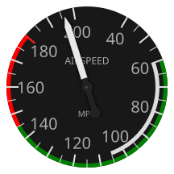<br><sub><code>nav.airspeed.DHC2</code></sub></a> | <a href="#nav-altitude-generic">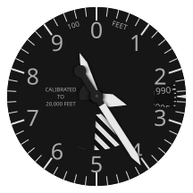<br><sub><code>nav.altitude.generic</code></sub></a> | <a href="#nav-attitude-generic">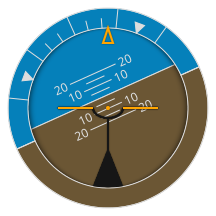<br><sub><code>nav.attitude.generic</code></sub></a> | <a href="#nav-attitude-ball">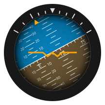<br><sub><code>nav.attitude.ball</code></sub></a> |
| <a href="#nav-compass-wet">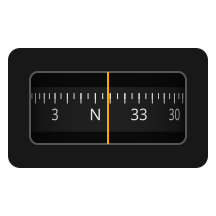<br><sub><code>nav.compass.wet</code></sub></a> | <a href="#nav-compass-wetTilting">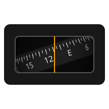<br><sub><code>nav.compass.wetTilting</code></sub></a> | <a href="#nav-heading-generic">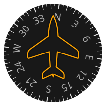<br><sub><code>nav.heading.generic</code></sub></a> | <a href="#nav-turnCoordinator-generic">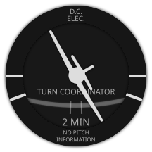<br><sub><code>nav.turnCoordinator.generic</code></sub></a> |
| <a href="#nav-VSI-generic">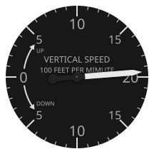<br><sub><code>nav.VSI.generic</code></sub></a> | <a href="#radionav-ADF-generic">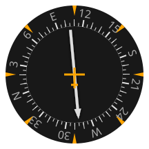<br><sub><code>radionav.ADF.generic</code></sub></a> | <a href="#radionav-VOR-generic">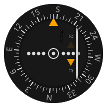<br><sub><code>radionav.VOR.generic</code></sub></a> | <a href="#radionav-transponder-KT76C">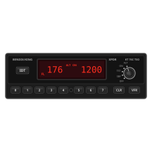<br><sub><code>radionav.transponder.KT76C</code></sub></a> |
| <a href="#engine-tachometer-DHC2">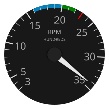<br><sub><code>engine.tachometer.DHC2</code></sub></a> | <a href="#engine-tachometer-jageype">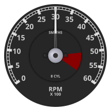<br><sub><code>engine.tachometer.jageype</code></sub></a> | <a href="#engine-speedometer-BMW">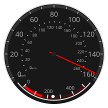<br><sub><code>engine.speedometer.BMW</code></sub></a> | <a href="#engine-odometer-classic">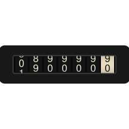<br><sub><code>engine.odometer.classic</code></sub></a> |
| <a href="#engine-suctionPressure-DHC2">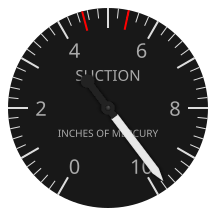<br><sub><code>engine.suctionPressure.DHC2</code></sub></a> | <a href="#engine-manifoldPressure-DHC2">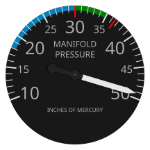<br><sub><code>engine.manifoldPressure.DHC2</code></sub></a> | <a href="#engine-fuel-generic">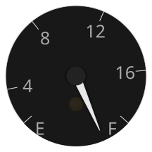<br><sub><code>engine.fuel.generic</code></sub></a> | <a href="#engine-fuel-DHC2">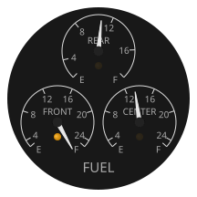<br><sub><code>engine.fuel.DHC2</code></sub></a> |
| <a href="#engine-oilFuelStatus-DHC2">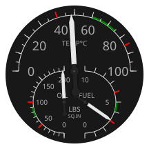<br><sub><code>engine.oilFuelStatus.DHC2</code></sub></a> | <a href="#engine-carbMixtureTemp-DHC2">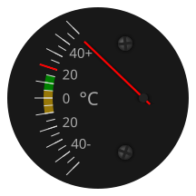<br><sub><code>engine.carbMixtureTemp.DHC2</code></sub></a> | <a href="#engine-cylinderHeadTemp-DHC2">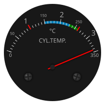<br><sub><code>engine.cylinderHeadTemp.DHC2</code></sub></a> | <a href="#electrical-ammeter-DHC2">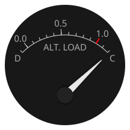<br><sub><code>electrical.ammeter.DHC2</code></sub></a> |
| <a href="#electrical-voltmeter-DHC2">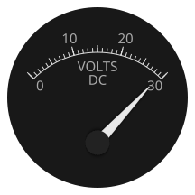<br><sub><code>electrical.voltmeter.DHC2</code></sub></a> | <a href="#clocks-simple">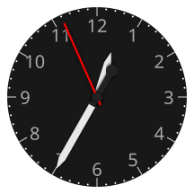<br><sub><code>clocks.simple</code></sub></a> | <a href="#clocks-casioF91W">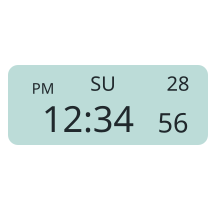<br><sub><code>clocks.casioF91W</code></sub></a> | <a href="#clocks-omegaSpeedmaster">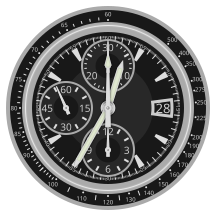<br><sub><code>clocks.omegaSpeedmaster</code></sub></a> |
| <a href="#switches-toggle">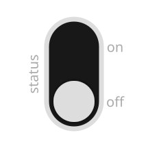<br><sub><code>switches.toggle</code></sub></a> | <a href="#switches-button">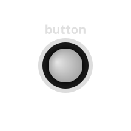<br><sub><code>switches.button</code></sub></a> | <a href="#switches-rotary">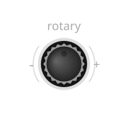<br><sub><code>switches.rotary</code></sub></a> | <a href="#switches-selector">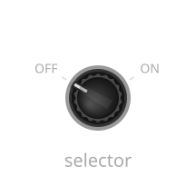<br><sub><code>switches.selector</code></sub></a> |
| <a href="#debug-alignment">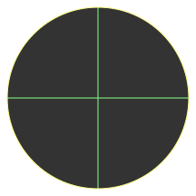<br><sub><code>debug.alignment</code></sub></a> |   |   |   |

## Flight Navigation (`g3.contrib.nav`)

<a id="nav-airspeed-DHC2" href="#nav-airspeed-DHC2">#</a>
g3.contrib.**nav.airspeed.DHC2**() · [source](../src/contrib/dhc2-nav.ts#L10-L28)


DHC-2 Beaver airspeed indicator displaying speed in knots/mph (40–200) with color-coded flap, normal operating, and caution arcs.

**Metrics:** `airspeed` (`knot`)

<details>
<summary>Factory implementation (<code>src/contrib/dhc2-nav.ts</code>, 19 lines)</summary>

```ts
export function airspeed(): GaugeComponent {
    return g3.gauge()
        .metric('airspeed').unit('knot')
        .fake(g3.forceSeries(40, 200))
        .measure(d3.scaleLinear().domain([40,200]).range([30, 350]))
        .append(
            g3.gaugeFace(),
            g3.axisSector([60, 105]).inset(10).size(5),  // flaps
            g3.axisSector([60, 145]).size(5).class('g3-normal-fill'),  // normal
            g3.axisSector([145, 180]).size(5).class('g3-danger-fill'),  // max
            g3.axisTicks().step(5).size(10),
            g3.axisTicks().step(10).size(15).style('stroke-width: 2'),
            g3.axisTicks([180]).size(15).class('g3-danger-stroke'),
            g3.axisLabels().step(20).inset(30),
            g3.gaugeLabel("AIRSPEED").size(12).y(-33),
            g3.gaugeLabel("MPH").y(33),
            g3.indicatePointer().shape('sword'),
        );
}
```
</details>

<br clear="both" />

---

<a id="nav-altitude-generic" href="#nav-altitude-generic">#</a>
g3.contrib.**nav.altitude.generic**() · [source](../src/contrib/nav.ts#L16-L73)


Three-pointer barometric altimeter (hundreds, thousands, and ten-thousands of feet) with a self-indicating Kollsman pressure window (hPa) and low-altitude striped warning sector.

**Metrics:** `altitude` (`ft`), `pressureSetting` (`hPa`)

<details>
<summary>Factory implementation (<code>src/contrib/nav.ts</code>, 58 lines)</summary>

```ts
export function altitudeGeneric(): GaugeComponent {
    return g3.gauge()
        .metric('altitude').unit('ft')
        .fake(g3.forceSeries(0, 30000, {fmax: 0.001}))
        .measure(d3.scaleLinear().domain([0, 1000]).range([0, 360]))
        .defs(
            g3.element('pattern', {
                id: 'altitudeDangerPattern',
                width: 10, height: 10,
                patternTransform: 'rotate(45)',
                patternUnits: 'userSpaceOnUse'
            }).append(g3.element('rect', {width: 10, height: 5}).class('g3-fg-fill')),
        )
        .append(
            // self-indicating gauge for pressure, to view through window
            g3.put().rotate(90).append(
                g3.gauge()
                    .metric('pressureSetting').unit('hPa')
                    .fake(g3.forceSeries(955, 1075))
                    .measure(d3.scaleLinear().domain([955,1075]).range([0, 360]))
                    .autoindicate(true)
                    .append(
                        g3.gaugeFace().style('fill: #111'),
                        g3.axisTicks().step(5).size(5).inset(10),
                        g3.axisTicks().step(1).size(3).inset(10),
                        g3.axisTicks([1013.25]).size(5).inset(10).class('g3-danger-stroke'),
                        g3.axisLabels(d3.range(955, 1075, 5)).size(10).orient('relative').rotate(-90),
                    )
            ),
            // add an inner circle with danger hatching
            g3.element('circle', {r: 65, fill: 'url(#altitudeDangerPattern)'}),
            // rotating cover for danger stripes, behind the main face
            // see https://www.cfinotebook.net/notebook/avionics-and-instruments/altimeter
            // A striped segment is visible below 10,000', when mask starts to cover, fully covered at 15,000'
            g3.indicatePointer().rescale(v => 3*v/100).append(
                g3.axisSector([625, 1125]).inset(40).size(60).class('g3-bg-fill')
            ).style('filter: url(#dropShadow1)'),
            // add a face with two see-through windows
            g3.gaugeFace().window((_: any, g: any) => {
                g3.axisSector([225, 275]).inset(11).size(24).style('fill: black')(_, g); // pressure window
                g3.axisSector([425, 575]).inset(40).size(40).style('fill: black')(_, g); // low-altitude danger window
            }).style('filter: url(#dropShadow3)'),  //TODO doesn't drop shadow windows properly?
            g3.axisTicks([250]).shape('wedge').size(10).width(3),
            g3.axisTicks().step(20),
            g3.axisTicks().step(100).size(15).style('stroke-width: 2'),
            g3.axisLabels().step(100).format(v => v/100).size(25),
            g3.axisLabels({950: '100', 50: 'FEET'}).orient('relative').size(8).inset(16),
            // g3.gaugeLabel("ALTITUDE").y(-10).size(15),
            g3.axisLabels({0: '1000 FEET'}).orient('clockwise').inset(50).size(8),
            g3.axisLabels({0: '10000 FEET'}).orient('clockwise').inset(62).size(8),
            g3.gaugeLabel("CALIBRATED").x(-40).y(-8).size(6),
            g3.gaugeLabel("TO").x(-40).y(0).size(6),
            g3.gaugeLabel("20,000 FEET").x(-40).y(8).size(6),
            g3.indicatePointer().shape('dagger').rescale(v => v/100),
            g3.indicatePointer().shape('blade').rescale(v => v/10),
            g3.indicatePointer().shape('sword'),
        );
}
```
</details>

<br clear="both" />

---

<a id="nav-attitude-generic" href="#nav-attitude-generic">#</a>
g3.contrib.**nav.attitude.generic**() · [source](../src/contrib/nav.ts#L80-L138)


Artificial horizon / attitude indicator combining a circular self-indicating roll dial with a clipped linear self-indicating pitch scale.

**Metrics:** `roll` (`deg`), `pitch` (`deg`)

<details>
<summary>Factory implementation (<code>src/contrib/nav.ts</code>, 59 lines)</summary>

```ts
export function attitudeGeneric(): GaugeComponent {
    return g3.gauge()
        // outer gauge is invisible other than the indicator marks
        .append(
            // the outer dial is a self-indicating roll gauge
            g3.gauge()
                .metric('roll').unit('deg')
                .fake(g3.forceSeries(-25, 25))
                .measure(d3.scaleLinear().domain([-90,90]).range([-90,90]))
                .autoindicate(true)
                .clip(g3.gaugeFace())
                .append(
                    // the inner dial is a self-indicating pitch gauge with a linear scale
                    g3.put().rotate(-90).append(
                        g3.gauge()
                            .metric('pitch').unit('deg')
                            .fake(g3.forceSeries(-25, 25))
                            .measure(d3.scaleLinear().domain([-20, 20]).range([-25,25]))
                            .kind('linear').autoindicate(true)
                            .css('text {fill: #ddd}')
                            .append(
                                g3.element('rect', {height: 200, width: 150, y: -100}) // sky
                                    .class('g3-sky-fill g3-fg-stroke'),
                                g3.element('rect', {height: 200, width: 150, x: -150, y: -100}) // ground
                                    .class('g3-ground-fill g3-fg-stroke'),
                                g3.axisTicks([-20,20]).size(50).inset(-25),
                                g3.axisTicks([-10,10]).size(30).inset(-15),
                                g3.axisTicks().start(-15).step(10).size(20).inset(-10),
                                g3.axisLabels([-20,20]).inset(35).format(Math.abs).rotate(90).size(12),
                                g3.axisLabels([-20,20]).inset(-35).format(Math.abs).rotate(90).size(12),
                                g3.axisLabels([-10,10]).inset(25).format(Math.abs).rotate(90).size(12),
                                g3.axisLabels([-10,10]).inset(-25).format(Math.abs).rotate(90).size(12),
                            )
                    ),
                    g3.axisSector([0, 360]).size(20).style('filter: url(#dropShadow3)'),
                    g3.axisSector([-90,90]).size(20).class('g3-sky-fill g3-fg-stroke'),
                    g3.axisSector([90,270]).size(20).class('g3-ground-fill g3-fg-stroke'),
                    g3.axisTicks().step(30).size(20),
                    g3.axisTicks([-45, 45]).shape('wedge').inset(10).size(10).width(10),
                    g3.axisTicks([-20,-10,10,20]).inset(10).size(10),
                ),
            // add outline, post-clipping to avoid losing half the exterior
            g3.element('circle', {r: 100}).class('g3-fg-stroke'),
            g3.put().append(
                // top pointer
                g3.element('path', {d: 'M 0,-80 l 5,15 l -10,0 z'})
                    .class('g3-highlight-stroke g3-no-fill'),
                // grey handlebar support
                g3.element('path', {d: 'M -15,0 a 15,10 0 0 0 30,0 M 0,10 l 0,35'})
                    .class('g3-bg-stroke').style('stroke-width: 2'),
                g3.element('path', {d: 'M 0,40 l 15,38 a 100,100 0 0 1 -30,0 z'})
                    .class('g3-bg-fill').style('stroke-width: 2'),
                // handlebar arms and dot
                g3.element('path', {d: 'M -50,0 l 35,0 m 30,0 l 35,0'})
                    .class('g3-highlight-stroke g3-no-fill').style('filter: url(#dropShadow1)'),
                g3.element('circle', {r: 2}).class('g3-highlight-fill'),
            ).style('filter: url(#dropShadow1)')
        );
}
```
</details>

<br clear="both" />

---

<a id="nav-attitude-ball" href="#nav-attitude-ball">#</a>
g3.contrib.**nav.attitude.ball**() · [source](../src/contrib/nav.ts#L159-L233)


Attitude indicator ball seen through a round faceplate aperture, rolling, pitching and turning in three dimensions with a heading scale along the horizon.

**Metrics:** `roll` (`deg`), `heading` (`deg`), `pitch` (`deg`)

<details>
<summary>Factory implementation (<code>src/contrib/nav.ts</code>, 75 lines)</summary>

```ts
export function attitudeBall(): GaugeComponent {
    const A = 78,       // faceplate aperture radius
        B = 104,        // the ball is larger than the aperture, so its edge is never seen
        w = arc(B);
    // the pitch ladder repeats every 30° of heading so it reads all the way round the ball
    const ladder = d3.range(0, 360, 30).flatMap(lon => [
        g3.axisTicks(d3.range(-80, 81, 10).filter(v => v)).inset(w(lon - 7)).size(w(14)).style('stroke: #fff'),
        g3.axisTicks(d3.range(-75, 76, 10)).inset(w(lon - 3)).size(w(6)).style('stroke: #fff'),
    ]);
    const ladderLabels = [0, 90, 180, 270].flatMap(lon => [-11, 11].map(dx =>
        g3.axisLabels(d3.range(-80, 81, 10).filter(v => v)).inset(w(lon + dx)).rotate(90).size(8).format(Math.abs)
    ));
    return g3.gauge()
        .defs(
            ballShading('g3-attitude-ball-shade', B),
            // shadow cast by the faceplate just inside the aperture
            g3.element('radialGradient', {id: 'g3-attitude-ball-rim', gradientUnits: 'userSpaceOnUse', cx: 0, cy: 0, r: A}).append(
                ...[[0.8, 0], [0.92, 0.3], [0.98, 0.6], [1, 0.8]].map(([offset, a]) =>
                    g3.element('stop', {offset, 'stop-color': '#000', 'stop-opacity': a}))
            ),
        )
        .css('text {fill: #fff}')
        .append(
            g3.gaugeFace(),
            // roll turns the whole ball in the plane of the panel
            g3.gauge()
                .metric('roll').unit('deg')
                .fake(g3.forceSeries(-30, 30))
                .measure(d3.scaleLinear().domain([-180, 180]).range([-180, 180]))
                .autoindicate(true)
                .clip(g3.element('circle', {r: A}))
                .append(
                    g3.gauge()
                        .kind('ball.yaw').r(B)
                        .metric('heading').unit('deg')
                        .fake(g3.forceSeries(0, 360, {wrap: true}))
                        .measure(d3.scaleLinear().domain([0, 360]).range([0, 360]))
                        .autoindicate(true)
                        .append(
                            g3.axisSector([0, 360]).inset(-w(90)).size(w(90)).class('g3-sky-fill'),
                            g3.axisSector([0, 360]).size(w(90)).class('g3-ground-fill'),
                            g3.axisLine().style('stroke: #fff; stroke-width: 1.5'),
                            g3.axisTicks().step(5).size(w(1.5)).style('stroke: #fff'),
                            g3.axisTicks().step(10).size(w(3)).style('stroke: #fff'),
                            g3.axisLabels().step(30).inset(w(6.5)).size(11).format(headingFormat),
                            // a pitch gauge nested in the heading ball pitches the same ball
                            g3.gauge()
                                .kind('ball.pitch')
                                .metric('pitch').unit('deg')
                                .fake(g3.forceSeries(-20, 20))
                                .measure(d3.scaleLinear().domain([-90, 90]).range([-90, 90]))
                                .autoindicate(true)
                                .append(...ladder, ...ladderLabels),
                        ),
                    g3.element('circle', {r: A, fill: 'url(#g3-attitude-ball-shade)'}),
                    g3.element('circle', {r: A, fill: 'url(#g3-attitude-ball-rim)'}),
                    // sky pointer turns with the horizon
                    g3.element('path', {d: `M 0,${-A + 1} l -5,10 l 10,0 z`}).class('g3-highlight-fill'),
                ),
            g3.element('circle', {r: A + 0.5}).style('stroke: #3a3a3a'),
            // bank scale painted on the faceplate
            g3.gauge()
                .r(A)
                .measure(d3.scaleLinear().domain([-180, 180]).range([-180, 180]))
                .append(
                    g3.axisTicks([-60, -30, 30, 60]).inset(-14).size(11).style('stroke-width: 2'),
                    g3.axisTicks([-45, -20, -10, 10, 20, 45]).inset(-9).size(6).style('stroke-width: 2'),
                    g3.element('path', {d: `M 0,${-A - 3} l -5,-10 l 10,0 z`}).class('g3-fg-fill'),
                ),
            // fixed aircraft symbol
            g3.element('path', {d: 'M -50,0 h 30 l 10,8 l 10,-8 l 10,8 l 10,-8 h 30'})
                .class('g3-highlight-stroke').style('stroke-width: 3; stroke-linejoin: round'),
            g3.element('circle', {r: 2}).class('g3-highlight-fill'),
        );
}
```
</details>

<br clear="both" />

---

<a id="nav-compass-wet" href="#nav-compass-wet">#</a>
g3.contrib.**nav.compass.wet**() · [source](../src/contrib/nav.ts#L241-L264)


Wet (whiskey) magnetic compass: a cylindrical card on a drum seen through a window, read from behind so east appears to the left of north. See nav.compass.wetTilting for a card that also tilts with pitch and roll.

**Metrics:** `heading` (`deg`)

<details>
<summary>Factory implementation (<code>src/contrib/nav.ts</code>, 24 lines)</summary>

```ts
export function wetCompass(): GaugeComponent {
    const win = {x: -78, y: -36, width: 156, height: 72, rx: 8};
    return g3.gauge()
        .defs(cardShading('g3-wet-compass-shade', 85))
        .css('text {fill: #eee}')
        .append(
            g3.element('rect', {x: -100, y: -60, width: 200, height: 120, rx: 12}).class('g3-gauge-face'),
            g3.gauge()
                .clip(g3.element('rect', win))
                .append(
                    g3.element('rect', win).style('fill: #0b0b0b'),
                    g3.gauge()
                        .kind('drum').r(85)
                        .metric('heading').unit('deg')
                        .fake(g3.forceSeries(0, 360, {wrap: true}))
                        // heading h sits at -h around the drum, so the card reads reversed
                        .measure(d3.scaleLinear().domain([0, 360]).range([0, -360]))
                        .autoindicate(true)
                        .append(...compassCard(arc(85))),
                    g3.element('rect', {...win, fill: 'url(#g3-wet-compass-shade)'}),
                ),
            ...compassCase(win),
        );
}
```
</details>

<br clear="both" />

---

<a id="nav-compass-wetTilting" href="#nav-compass-wetTilting">#</a>
g3.contrib.**nav.compass.wetTilting**() · [source](../src/contrib/nav.ts#L275-L317)


Wet compass whose card hangs level on its pivot, so it appears to tilt in the window as the aircraft pitches and rolls, up to the stops at about 18° either way. Its heading is the aircraft's, without the turning and acceleration errors of a real compass, or the swing of the card as it settles. For those, bind the `heading` metric to an indicated heading from your own compass model, for example a damped spring that lags and overshoots the true heading, plus the northerly turning and acceleration errors.

**Metrics:** `roll` (`deg`), `heading` (`deg`), `pitch` (`deg`)

<details>
<summary>Factory implementation (<code>src/contrib/nav.ts</code>, 43 lines)</summary>

```ts
export function wetCompassTilting(): GaugeComponent {
    const B = 85,
        w = arc(B),
        tilt = d3.scaleLinear().domain([-18, 18]).range([-18, 18]).clamp(true),
        win = {x: -78, y: -36, width: 156, height: 72, rx: 8};
    return g3.gauge()
        .defs(ballShading('g3-wet-compass-tilting-shade', B))
        .css('text {fill: #eee}')
        .append(
            g3.element('rect', {x: -100, y: -60, width: 200, height: 120, rx: 12}).class('g3-gauge-face'),
            g3.gauge()
                .clip(g3.element('rect', win))
                .append(
                    g3.element('rect', win).style('fill: #0b0b0b'),
                    // the card stays level as the case rolls around it
                    g3.gauge()
                        .metric('roll').unit('deg')
                        .fake(g3.forceSeries(-25, 25))
                        .measure(tilt)
                        .autoindicate(true)
                        .append(
                            g3.gauge()
                                .kind('ball.yaw').r(B)
                                .metric('heading').unit('deg')
                                .fake(g3.forceSeries(0, 360, {wrap: true}))
                                .measure(d3.scaleLinear().domain([0, 360]).range([0, -360]))
                                .autoindicate(true)
                                .append(
                                    ...compassCard(w),
                                    // an empty pitch gauge pitches the shared ball, so the card dips as the nose rises
                                    g3.gauge()
                                        .kind('ball.pitch')
                                        .metric('pitch').unit('deg')
                                        .fake(g3.forceSeries(-15, 15))
                                        .measure(tilt)
                                        .autoindicate(true),
                                ),
                        ),
                    g3.element('rect', {...win, fill: 'url(#g3-wet-compass-tilting-shade)'}),
                ),
            ...compassCase(win),
        );
}
```
</details>

<br clear="both" />

---

<a id="nav-heading-generic" href="#nav-heading-generic">#</a>
g3.contrib.**nav.heading.generic**() · [source](../src/contrib/nav.ts#L348-L362)


Directional gyro / heading indicator with a rotating 360° compass card and fixed aircraft reference symbol.

**Metrics:** `heading` (`deg`)

<details>
<summary>Factory implementation (<code>src/contrib/nav.ts</code>, 15 lines)</summary>

```ts
export function headingGeneric(): GaugeComponent {
    return g3.gauge()
        .metric('heading').unit('deg')
        .fake(g3.forceSeries(0, 360, {wrap: true}))
        .measure(d3.scaleLinear().domain([0, 360]).range([0, 360]))
        .autoindicate(true)
        .append(
            g3.gaugeFace(),
            g3.axisTicks().step(5).size(5),
            g3.axisTicks().step(10).size(10),
            g3.axisTicks().step(30).size(10).style('stroke-width: 2'),
            g3.axisLabels().step(30).orient('relative').format(headingFormat),
            g3.indicatePointer().shape('aircraft-heading'),
        );
}
```
</details>

<br clear="both" />

---

<a id="nav-turnCoordinator-generic" href="#nav-turnCoordinator-generic">#</a>
g3.contrib.**nav.turnCoordinator.generic**() · [source](../src/contrib/nav.ts#L402-L444)


Turn coordinator combining a miniature aircraft turn-rate pointer (deg/s) with an inclinometer slip/skid ball tube.

**Metrics:** `turnrate` (`deg/s`), `slip` (`deg`)

<details>
<summary>Factory implementation (<code>src/contrib/nav.ts</code>, 43 lines)</summary>

```ts
export function turnCoordinatorGeneric(): GaugeComponent {
    return g3.gauge()
        .metric('turnrate').unit('deg/s')
        .fake(g3.forceSeries(-10, 10))
        .measure(d3.scaleLinear().domain([-3, 3]).range([-20, 20]))
        .append(
            // gaguge for slip, degrees of ball deflection
            g3.gauge()
                .metric('slip').unit('deg')
                .fake(g3.forceSeries(-25, 25))
                .measure(d3.scaleLinear().domain([-20,20]).range([170,190]))
                .r(300)
                .append(
                    g3.gaugeFace(),
                    g3.gaugeLabel('TURN COORDINATOR').size(11).y(22),
                    g3.gaugeLabel('2 MIN').size(14).y(65),
                    g3.put().y(-255).append(
                        // background for the tube
                        g3.axisSector([-30,30]).inset(-9).size(18).style('fill: #c0c0a8; filter: url(#dropShadow3)'),
                        // add ball as pointer
                        g3.indicatePointer().clamp([-20,20]).append(
                            g3.put().scale(0.8,1).y(-300).rotate(-180).append(
                                // add ball background plus a highlight, with the rotate(-180) to avoid having
                                // the highlight flipped since the ball is tyipcally indicating near 180 rotation
                                g3.element('circle', {r: 8}).style('fill: #333'),
                                g3.element('circle', {r: 8}).class('g3-highlight'),
                            )
                        ),
                        g3.axisTicks([-3,3]).inset(-9).size(18).style('stroke-width: 2; stroke: #666'),
                        // add a blurred highlight to the tube
                        g3.axisSector([-30,30]).inset(0).size(6)
                            .style('fill: white; filter: url(#gaussianBlur1); fill-opacity: 0.33')
                    )
                ),
            g3.axisSector([0,360]).size(24).class('g3-bg-fill').style('filter: url(#dropShadow2)'),
            g3.axisTicks([-16.5, -13.5, 13.5, 16.5]).size(24).style('stroke-width: 4'),
            g3.gaugeLabel('D.C.').y(-92),
            g3.gaugeLabel('ELEC.').y(-82),
            g3.gaugeLabel('NO PITCH').y(80).size(8),
            g3.gaugeLabel('INFORMATION').y(90).size(8),
            g3.indicatePointer().clamp([-9,9]).shape('aircraft-turn'),
        );
}
```
</details>

<br clear="both" />

---

<a id="nav-VSI-generic" href="#nav-VSI-generic">#</a>
g3.contrib.**nav.VSI.generic**() · [source](../src/contrib/nav.ts#L368-L396)


Vertical speed indicator (VSI) measuring rate of climb or descent (±2,000 ft/min) with clamped pointer stops.

**Metrics:** `verticalSpeed` (`ft/min`)

<details>
<summary>Factory implementation (<code>src/contrib/nav.ts</code>, 29 lines)</summary>

```ts
export function VSIGeneric(): GaugeComponent {
    return g3.gauge()
        .metric('verticalSpeed').unit('ft/min')
        .fake(g3.forceSeries(-2500, 2500))
        .measure(d3.scaleLinear().domain([-2000, 2000]).range([90, 90+360]))
        .append(
            g3.gaugeFace(),
            g3.axisTicks().step(100).size(5),
            g3.axisTicks().step(500).size(15).style('stroke-width: 2'),
            g3.axisLabels().step(1000).format(v => Math.abs(v/100)),
            g3.axisLabels().step(1000).start(-1500).format(v => Math.abs(v/100)).size(16),
            g3.gaugeLabel("VERTICAL SPEED").y(-25).size(12),
            g3.gaugeLabel("100 FEET PER MIMUTE").y(-10).size(10),
            // add up/down arrows as sector lines plus custom tick marks
            g3.axisSector([100,400]).size(0).inset(25).class('g3-fg-stroke').style('stroke-width: 2'),
            g3.axisSector([-100,-400]).size(0).inset(25).class('g3-fg-stroke').style('stroke-width: 2'),
            // TODO this should be a custom tick mark shape, with access to current tick val?
            (_: any, g: any) => {
                _.selectAll(null).data([-400, 400])
                .enter().append('path')
                    .attr('d', "M 2,0 l -7,4 l 0,-8 Z")
                    .attr('transform', (d: any) => g.marktransform(d, 25) + (d < 0 ? ' rotate(-180)':''))
                    .attr('class', 'g3-fg-fill');
            },
            g3.gaugeLabel("UP").x(-57).y(-37).size(8).style('text-anchor: start'),
            g3.gaugeLabel("DOWN").x(-57).y(37).size(8).style('text-anchor: start'),
            g3.indicatePointer().shape('sword').clamp([-1950, 1950]),
        );
}
```
</details>

<br clear="both" />

---

## Radio Navigation (`g3.contrib.radionav`)

<a id="radionav-ADF-generic" href="#radionav-ADF-generic">#</a>
g3.contrib.**radionav.ADF.generic**() · [source](../src/contrib/radionav.ts#L84-L115)


Automatic Direction Finder (ADF) relative bearing indicator with a rotating compass card.

**Metrics:** `relativeADF` (`deg`), `headingADF` (`deg`)

<details>
<summary>Factory implementation (<code>src/contrib/radionav.ts</code>, 32 lines)</summary>

```ts
export function ADFGeneric(): GaugeComponent {
    return g3.gauge()
        .metric('relativeADF').unit('deg')
        .fake(g3.forceSeries(0, 360, {wrap: true}))
        .measure(d3.scaleLinear().domain([0, 360]).range([0, 360]))
        .append(
            // pilot set heading gauge
            g3.gauge()
                .metric('headingADF').unit('deg')
                .fake(g3.forceSeries(0, 360, {wrap: true}))
                .measure(d3.scaleLinear().domain([0, 360]).range([0, 360]))
                .autoindicate(true)
                .append(
                    g3.axisSector([0,360]).size(30).class('g3-bg-fill'),
                    g3.axisTicks().step(5).inset(30).size(-5),
                    g3.axisTicks().step(10).inset(30).size(-10),
                    g3.axisTicks().step(30).inset(30).size(-10).style('stroke-width: 2'),
                    g3.axisLabels().step(30).inset(10).size(16).orient('relative').format(headingFormat),
                ),
            g3.gaugeFace().r(70),
            // arrow ADF bearing indicator
            g3.indicatePointer().append(
                g3.element('path', {d: 'M 0,-65 L 0,60'}).class('g3-fg-stroke').style('stroke-width: 4'),
                g3.element('path', {d: 'M 0,65 l 5,-15 l -10,0 z'}).class('g3-fg-fill'),
            ),
            // heading marks
            g3.axisTicks().step(45).shape('wedge').size(15).width(6).class('g3-highlight-fill g3-no-stroke'),
            // aircraft marker
            g3.element('path', {d: 'M 0,-10 l 0,30 m 5,-5 l -10,0 M 15,0 l -30,0'})
                .class('g3-highlight-stroke').style('stroke-width: 3'),
        );
}
```
</details>

<br clear="both" />

---

<a id="radionav-VOR-generic" href="#radionav-VOR-generic">#</a>
g3.contrib.**radionav.VOR.generic**() · [source](../src/contrib/radionav.ts#L14-L78)


VHF Omnidirectional Range (VOR) course deviation indicator (CDI) with a rotating omni-bearing selector (OBS) ring, linear radial deviation needle, and TO/FROM/NAV status flags.

**Metrics:** `radialDeviation` (`deg`), `toFromVOR`, `radialVOR` (`deg`)

<details>
<summary>Factory implementation (<code>src/contrib/radionav.ts</code>, 65 lines)</summary>

```ts
export function VORGeneric(): GaugeComponent {
    return g3.gauge()
        // the inner part of the VOR gauge measures the deviation from selected radial
        .metric('radialDeviation').unit('deg')
        .fake(g3.forceSeries(-10, 10))
        .measure(deviationScale)
        .kind('linear')
        .clip(g3.gaugeFace())
        .append(
            g3.gaugeFace(),
            // dots show every two degrees of deviation, with an extra central dot
            g3.axisTicks([-10,-8,-6,-4,0,4,6,8,10]).shape('dot').size(3),
            g3.element('circle', {r: deviationScale(2)}).class('g3-axis-ticks').style('stroke-width: 2; fill: none'),
            g3.gaugeLabel('TO').x(35).y(-35).size(8),
            g3.gaugeLabel('FR').x(35).y(35).size(8),
            // use a single styled gauge to flip to/from/unreliable
            // draw the 'to' state with a greyed out 'from' state
            g3.element('path', {d: 'M 35,25 l 8,-14 l -16,0 z'}).class('g3-highlight-fill'),
            g3.element('path', {d: 'M 35,-25 l 8,14 l -16,0 z'}).class('g3-bg-fill'),
            g3.gauge()
                .metric('toFromVOR')  // 1: to, -1: from, 0: off
                .fake(g3.categoricalSeries([1, 0, -1]))
                .append(
                    g3.indicateStyle().trigger(v => v == -1 ? 0.9 : 0.1).append(
                        // overlay a slightly (or very) transparent 'from' state
                        g3.element('path', {d: 'M 35,25 l 8,-14 l -16,0 z'}).class('g3-bg-fill'),
                        g3.element('path', {d: 'M 35,-25 l 8,14 l -16,0 z'}).class('g3-highlight-fill'),
                    ),
                ),
            // similarly, show unreliability by drawing background over to/from plus the NAV indicator
            g3.gauge()
                .metric('toFromVOR')
                .append(
                    g3.indicateStyle().trigger(v => v == 0 ? 1 : 0).append(
                        g3.element('path', {d: 'M 35,-25 l 8,14 l -16,0 z'}).class('g3-bg-fill'),
                        g3.element('path', {d: 'M 35,25 l 8,-14 l -16,0 z'}).class('g3-bg-fill'),
                        g3.element('rect', {x: 10, width: 12, y: -50, height: 30}).style('fill: red'),
                    ),
                ),
            g3.put().y(-35).x(16).css('text {fill: black}').append(
                g3.gaugeLabel('N').y(-9),
                g3.gaugeLabel('A'),
                g3.gaugeLabel('V').y(9),
            ),
            g3.indicatePointer().append(
                g3.element('path', {d: 'M 0,-100 L 0,100'}).class('g3-fg-stroke').style('stroke-width: 4')
            ),
            g3.gauge()
                // the outer ring auto-indicates to show the radial heading
                .metric('radialVOR').unit('deg')
                .fake(g3.forceSeries(0, 360, {wrap: true}))
                .measure(d3.scaleLinear().domain([0, 360]).range([0, 360]))
                .autoindicate(true)
                .append(
                    g3.axisSector([0,360]).size(30).style('filter: url(#dropShadow3)').class('g3-bg-fill'),
                    g3.axisTicks().step(5).inset(30).size(-5),
                    g3.axisTicks().step(10).inset(30).size(-10),
                    g3.axisTicks().step(30).inset(30).size(-10).style('stroke-width: 2'),
                    g3.axisLabels().step(30).inset(10).size(16).orient('relative').format(headingFormat),
                ),
            // top triangular indicator
            g3.element('path', {d: 'M 0,-80 l 0,10 l 8,14 l -16,0 l 8,-14 z'})
                .class('g3-highlight-fill g3-highlight-stroke'),
        );
}
```
</details>

<br clear="both" />

---

<a id="radionav-transponder-KT76C" href="#radionav-transponder-KT76C">#</a>
g3.contrib.**radionav.transponder.KT76C**([*opts*: KT76COptions]) · [source](../src/contrib/radionav.ts#L153-L275)


Bendix/King KT 76C TSO panel-mount aviation transponder with a 7-segment gas-discharge display (flight level, mode annunciators and 4-digit squawk code), a 5-position mode selector (`OFF / SBY / TST / ON / ALT`), `IDT` ident button, and `0–7 / CLR / VFR` code entry buttons. A new code is only set once all four digits have been entered.

**Parameters:**
- `opts` (*KT76COptions*): Optional metric names for `code`, `mode`, `ident` and `altitude`

**Metrics:** `altitude.pressure` (`ft`), `transponderMode`, `transponderCode`

<details>
<summary>Factory implementation (<code>src/contrib/radionav.ts</code>, 123 lines)</summary>

```ts
export function transponderKT76C(opts: KT76COptions = {}): GaugeComponent {
    const code = opts.code ?? 'transponderCode',
        mode = opts.mode ?? 'transponderMode',
        ident = opts.ident ?? 'transponderIdent',
        altitude = opts.altitude ?? 'altitude.pressure';

    const isMode = (v: any, ...modes: KT76CMode[]) => modes.some(s => Number(v) === KT76C_MODES.indexOf(s));
    const squawk = (v: any) => v === undefined || v === null || v === '' ? '----' : String(v).padStart(4, '0');

    // local UI state for each drawn transponder: the digits typed so far, and what to show without them
    type EntryState = { entry: string; code?: any; mode?: any; text?: d3.Selection<SVGTextElement, unknown, null, undefined> };
    const state = d3.local<EntryState>();

    function redraw(s: EntryState) {
        s.text?.text(isMode(s.mode, 'TST') ? '8888' : s.entry ? s.entry.padEnd(4, '-') : squawk(s.code));
    }

    const init: RenderFunction = (sel: SelectorOrSelection) => {
        state.set(gaugeNode(sel, 'kt76c'), { entry: '' });
    };

    // the code readout combines the reported code and mode with any digits being typed
    const codeReadout: RenderFunction = (sel: SelectorOrSelection, g?: GaugeComponent) => {
        const text = g3.d3sel(sel).append('text').attr('font-size', 12.5).attr('class', 'kt76c-digits'),
            s = state.get(text.node() as Element)!;
        s.text = text as any;
        if (g3.activeController && g) {
            g3.activeController.register((v, _t, metrics) => {
                s.code = v;
                s.mode = metrics?.[mode];
                redraw(s);
            }, g.metrics(), g.unit());
        }
        redraw(s);
    };

    const enter = (update: (entry: string) => string, commit?: string) => (e: Event, g: GaugeComponent) => {
        const s = state.get(e.currentTarget as Element)!;
        s.entry = commit === undefined ? update(s.entry) : '';
        if (s.entry.length == 4) {
            g.send({ op: 'set', metric: code, value: s.entry });
            s.entry = '';
        } else if (commit !== undefined) {
            g.send({ op: 'set', metric: code, value: commit });
        }
        redraw(s);
    };

    const annunciator = (text: string, cls: string, x: number, y: number, lit: (v: any, metrics?: Record<string, any>) => boolean) =>
        g3.indicateStyle().trigger((v, metrics) => lit(v, metrics) ? 1 : 0).append(
            g3.put().class(cls).append(
                g3.gaugeLabel(text, {x, y, size: 3.6}).class('kt76c-segment'),
            )
        );

    const keypadButton = (label: string, x: number, width: number, onPress: (e: Event, g: GaugeComponent) => void) =>
        g3.put().x(x).y(20).scale(0.16).append(
            buttonFactory(undefined, label, { shape: 'rect', width, height: 56, onPress })
        );

    const digitPositions = [-86, -69, -52, -35, -18, 4, 21, 38];

    return g3.gauge()
        .class('kt76c')
        .append(
            init,
            // rack bezel and recessed faceplate
            g3.element('rect', {x: -100, y: -32, width: 200, height: 64, rx: 3}).class('kt76c-bezel'),
            g3.element('rect', {x: -97, y: -29, width: 194, height: 40, rx: 2}).class('kt76c-face'),
            g3.gaugeLabel('BENDIX/KING', {x: -76, y: -23.5, size: 4.1}).class('kt76c-silkscreen'),
            g3.gaugeLabel('XPDR', {x: 52, y: -23.5, size: 4.1}).class('kt76c-silkscreen'),
            g3.gaugeLabel('KT 76C TSO', {x: 80, y: -23.5, size: 3.7}).class('kt76c-silkscreen'),

            g3.put().x(-76).y(-8).scale(0.2).append(
                buttonFactory(undefined, 'IDT', { shape: 'rect', width: 92, height: 52, mode: 'trigger', event: ident })
            ),

            // display window
            g3.element('rect', {x: -55, y: -24, width: 98, height: 29, rx: 1.5}).class('kt76c-window'),
            g3.element('rect', {x: -53, y: -22, width: 94, height: 25, rx: 1}).class('kt76c-window-inner'),

            // flight level, shown in ALT and TST
            g3.gauge().metric(altitude, mode).unit('ft').fake(g3.forceSeries(1000, 18000)).append(
                g3.indicateStyle().trigger((_v, metrics) => isMode(metrics?.[mode], 'ALT', 'TST') ? 1 : 0).append(
                    g3.gaugeLabel('FL', {x: -47, y: -3, size: 4.2}).class('kt76c-segment'),
                    g3.put().x(-30).y(-9).class('kt76c-fl').append(
                        g3.indicateText().size(12.5).class('kt76c-digits')
                            .format((v, metrics) => isMode(metrics?.[mode], 'TST')
                                ? '888'
                                : d3.format('03d')(Math.max(0, Math.round((Number(v) || 0) / 100))))
                    ),
                )
            ),

            // mode annunciators, and R while replying to an ident (or in TST)
            g3.gauge().metric(mode, ident).append(
                annunciator('ALT', 'kt76c-alt', -11, -15.5, v => isMode(v, 'ALT', 'TST')),
                annunciator('ON', 'kt76c-on', -2, -15.5, v => isMode(v, 'ON', 'ALT', 'TST')),
                annunciator('SBY', 'kt76c-sby', -7, -3, v => isMode(v, 'SBY', 'TST')),
                annunciator('R', 'kt76c-reply', 5, -15.5,
                    (v, metrics) => isMode(v, 'TST') || (!!metrics?.[ident] && isMode(v, 'ON', 'ALT'))),
            ),

            // squawk code, shown unless OFF
            g3.gauge().metric(code, mode).fake('1200').append(
                g3.indicateStyle().trigger((_v, metrics) => isMode(metrics?.[mode], 'OFF') ? 0 : 1).append(
                    g3.put().x(22).y(-9).class('kt76c-code').append(codeReadout),
                )
            ),

            g3.put().x(76).y(-4).scale(0.24).append(
                selectorFactory(mode, '', [...KT76C_MODES], { range: [-135, -20] }).fake(KT76C_MODES.indexOf('ALT'))
            ),

            // keypad: octal digits, ambient light sensor, CLR backs up one digit, VFR sets 1200
            ...digitPositions.map((x, digit) =>
                keypadButton(String(digit), x, 82, enter(entry => entry + digit))
            ),
            g3.element('circle', {cx: -7, cy: 20, r: 2.2}).class('kt76c-photocell'),
            keypadButton('CLR', 61, 96, enter(entry => entry.slice(0, -1))),
            keypadButton('VFR', 83, 96, enter(entry => entry, '1200')),
        );
}
```
</details>

<br clear="both" />

---

## Engine Instruments (`g3.contrib.engine`)

<a id="engine-tachometer-DHC2" href="#engine-tachometer-DHC2">#</a>
g3.contrib.**engine.tachometer.DHC2**() · [source](../src/contrib/dhc2-engine.ts#L55-L73)


DHC-2 Beaver engine tachometer (300–3,500 RPM) with idle and normal operating sectors.

**Metrics:** `engineRPM` (`rpm`)

<details>
<summary>Factory implementation (<code>src/contrib/dhc2-engine.ts</code>, 19 lines)</summary>

```ts
export function tachometer(): GaugeComponent {
    return g3.gauge()
        .metric('engineRPM').unit('rpm')
        .fake(g3.forceSeries(300, 3500))
        .measure(d3.scaleLinear().domain([300, 3500]).range([225, 495]))
        .append(
            g3.gaugeFace(),
            g3.axisSector([1600, 2000]).size(7).class('g3-cold-fill'), // idle
            g3.axisSector([2000, 2200]).size(7).class('g3-normal-fill'), // normal
            g3.axisTicks().step(100).size(10),
            g3.axisTicks().step(500).size(15).style('stroke-width: 2'),
            g3.axisTicks([2300]).size(15).class('g3-danger-stroke'),
            g3.axisLabels().step(500).inset(30).format(v => v/100),
            g3.axisLabels([300]).format(v => v/100),
            g3.gaugeLabel('RPM').size(12).y(-45),
            g3.gaugeLabel('HUNDREDS').size(8).y(-30),
            g3.indicatePointer().shape('rondel'),
        );
}
```
</details>

<br clear="both" />

---

<a id="engine-tachometer-jageype" href="#engine-tachometer-jageype">#</a>
g3.contrib.**engine.tachometer.jageype**() · [source](../src/contrib/jagetype.ts#L10-L59)


Classic Smiths 8-cylinder positive-earth tachometer (0–6,000 RPM) from a Jaguar E-Type, featuring a redline sector (5,000–6,000 RPM) and custom two-tone pointer.

**Metrics:** `engineRPM` (`rpm`)

<details>
<summary>Factory implementation (<code>src/contrib/jagetype.ts</code>, 50 lines)</summary>

```ts
export function tachometer(): GaugeComponent {
    return g3.gauge()
        .metric('engineRPM').unit('rpm')
        .measure(d3.scaleLinear().domain([0,6000]).range([-125,125]))
        .css(`
text.g3-gauge-label, .g3-axis-labels text {
    font-stretch: normal;
    font-weight: 600;
    fill: #ccc;
}
.g3-gauge-face { fill: #282828 }
`)
        .append(
            g3.gaugeFace(),
            g3.gaugeFace().r(50).style('filter: url(#dropShadow2)'),
            g3.axisSector([5000,6000]).inset(50).size(35).style('fill: #800'),
            g3.gaugeLabel('SMITHS').y(-45).size(7),
            g3.gaugeLabel('8 CYL').y(40).size(7),
            // a trick to put a circular path label opposite the 3000RPM top of the gauge
            g3.put().rotate(180).append(
                g3.axisLabels({3000: 'POSITIVE EARTH'}).orient('counterclockwise').size(3.5).inset(52)
            ),
            g3.gaugeLabel('RPM').y(65).size(12),
            g3.gaugeLabel('X 100').y(75).size(8),
            g3.gaugeScrew().shape('phillips').r(3).x(-20),
            g3.gaugeScrew().shape('phillips').r(3).x(20),
            g3.put().scale(0.95).append(
                g3.axisSector().style('fill: none; stroke: white'),
                g3.axisTicks().step(500).style('stroke-width: 5'),
                g3.axisTicks().step(100).size(5),
                g3.axisLabels().inset(20).size(15).format(v => v/100),
                g3.indicatePointer().append(
                    // the full pointer blade
                    g3.element('path', {d: 'M 3,0 l -1.5,-90 l -1.5,-5 l -1.5,5 l -1.5,90 z'})
                        .style('fill: #ddd'),
                    // the bottom half of the pointer, drawn over the full blade
                    g3.element('path', {d: 'M 3,0 l -0.75,-45 l -4.5,0 l -0.75,45 z'})
                        .style('fill: #333'),
                    // a blurred highlight on the blade to give a bit of 3D effect
                    g3.element('path', {d: 'M -1,0 l 0,-90 l 2,0 z'})
                        .style('fill: white; filter: url(#gaussianBlur1); opacity: 0.5'),
                    // the central hub, with a highlight
                    g3.element('circle', {r: 15}).style('fill: #ccd'),
                    g3.element('circle', {r: 15}).class('g3-highlight'),
                    // the central pin
                    g3.element('circle', {r: 5}).style('fill: #333'),
                ),
            ),
        );
}
```
</details>

<br clear="both" />

---

<a id="engine-speedometer-BMW" href="#engine-speedometer-BMW">#</a>
g3.contrib.**engine.speedometer.BMW**() · [source](../src/contrib/speedometer.ts#L10-L47)


Dual-scale automotive speedometer (mph outer scale, km/h inner scale) with a lower remaining-range sector bar and destination distance marker.

**Metrics:** `speed` (`mph`), `range` (`mi`), `destination` (`mi`)

<details>
<summary>Factory implementation (<code>src/contrib/speedometer.ts</code>, 38 lines)</summary>

```ts
export function speedometerBMW(): GaugeComponent {
    return g3.gauge()
        .metric('speed').unit('mph').fake(g3.forceSeries(9, 160))
        .measure(d3.scaleLinear().domain([0,160]).range([-120,120]))
        .append(
            g3.gaugeFace(),
            g3.axisSector([-3,163]).size(1).inset(-1).class('g3-axis-line'),
            g3.axisSector([-3,163]).inset(2).size(5).style('fill: #333'),
            g3.axisTicks().step(10).inset(2).size(5),
            g3.axisLabels().step(20).size(14).inset(20).format(v => v.toString().padEnd(3, '\u00A0')),
            g3.axisLabels({'-3': 'mph'}).inset(24).size(6),
            g3.gauge().metric('speed').unit('km/h')
                .measure(d3.scaleLinear().domain([0,1.60934*160]).range([-120,120]))
                .r(66)
                .append(
                    g3.axisTicks(d3.range(0,261,10)).step(10).size(3),
                    g3.axisLabels(d3.range(0,261,20)).size(8).inset(12).format(v => v.toString().padEnd(3, '\u00A0')),
                    g3.axisLabels({'-5': '\u00A0km/h'}).inset(16).size(5),
                ),
            g3.indicatePointer(),
            g3.gauge().metric('range').unit('mi').fake(g3.forceSeries(0, 500))
                .measure(d3.scaleLinear().domain([-100,600]).range([240,120]))
                .r(90)
                .append(
                    g3.axisSector([-50,550]).size(1).inset(-3).class('g3-axis-line'),
                    g3.axisTicks(d3.range(0,500,10)).style('stroke: #800').size(5),
                    g3.axisLabels(d3.range(0,500,200)).size(10).inset(15),
                    g3.indicateSector().size(5).style('fill: red'),
                    g3.axisTicks(d3.range(0,501,100)).size(8).style('stroke-width: 2'),
                    g3.axisLabels({500: 'miles'}).orient('counterclockwise').size(6).inset(-7),
                ),
            g3.gauge().metric('destination').unit('mi').fake(g3.forceSeries(0, 500))
                .measure(d3.scaleLinear().domain([-100,600]).range([240,120]))
                .append(
                    g3.indicatePointer().append(g3.element('circle', {cy: -85, r: 4})).style('fill: white; stroke: black; filter: none;')
                ),
        );
}
```
</details>

<br clear="both" />

---

<a id="engine-odometer-classic" href="#engine-odometer-classic">#</a>
g3.contrib.**engine.odometer.classic**() · [source](../src/contrib/speedometer.ts#L73-L126)


Classic mechanical odometer: a row of numbered drums behind a slot, with a contrasting tenths drum on the right. Each drum is a horizontal drum gauge, and the drums carry as they roll over, so 89999.9 rolls smoothly to 90000.0.

**Metrics:** `odometer` (`mi`)

<details>
<summary>Factory implementation (<code>src/contrib/speedometer.ts</code>, 54 lines)</summary>

```ts
export function odometerClassic(): GaugeComponent {
    const n = 7,            // six whole digits and tenths
        w = 22,             // width of each drum
        gap = 2,
        R = 26,             // drum radius: digits sit 36° apart, about 16 units
        win = {x: -n * (w + gap) / 2 - 2, y: -15, width: n * (w + gap) + 4, height: 30, rx: 3};
    const drum = (k: number) => g3.put()
        .x(win.x + 2 + gap / 2 + (n - 1 - k) * (w + gap) + w / 2)
        // a drum spins about its vertical axis, so lay it on its side to roll digits up the slot
        .rotate(90)
        .append(
            g3.gauge()
                .kind('drum').r(R)
                .metric('odometer').unit('mi')
                .rescale((v: number) => odometerDrums(v, n)[k])
                .measure(d3.scaleLinear().domain([0, 10]).range([0, 360]))
                .autoindicate(true)
                .append(
                    g3.axisSector([0, 10]).inset(-w / 2).size(w)
                        .class(k == 0 ? 'g3-odometer-tenths' : 'g3-odometer-drum'),
                    g3.axisLabels(d3.range(10)).inset(0).rotate(-90).size(17).format(String),
                ),
        );
    return g3.gauge()
        .defs(
            // drums darken towards the top and bottom of the slot as they curve away
            g3.element('linearGradient', {id: 'g3-odometer-shade', gradientUnits: 'userSpaceOnUse', x1: 0, y1: -R, x2: 0, y2: R}).append(
                ...[0, 0.1, 0.2, 0.3, 0.4, 0.5, 0.6, 0.7, 0.8, 0.9, 1].map(f => {
                    const s = Math.abs(2 * f - 1);
                    return g3.element('stop', {offset: f, 'stop-color': '#000', 'stop-opacity': +(0.9 * (1 - Math.sqrt(1 - s * s))).toFixed(3)});
                })
            ),
        )
        .css(`
            .g3-odometer-drum {fill: #151515}
            .g3-odometer-drum ~ .g3-axis-labels text {fill: #f2ead8; font-family: Helvetica, Arial, sans-serif}
            .g3-odometer-tenths {fill: #e9dcc0}
            .g3-odometer-tenths ~ .g3-axis-labels text {fill: #111; font-family: Helvetica, Arial, sans-serif}
        `)
        .append(
            g3.element('rect', {x: -110, y: -32, width: 220, height: 64, rx: 10}).class('g3-gauge-face'),
            g3.gauge()
                .clip(g3.element('rect', win))
                .append(
                    g3.element('rect', win).style('fill: #050505'),
                    // only one drum needs to fake the shared metric, starting just before a rollover
                    g3.gauge().metric('odometer').unit('mi')
                        .fake((v?: number) => v === undefined ? 89999.7 : v + 0.02),
                    ...d3.range(n).map(drum),
                    g3.element('rect', {...win, fill: 'url(#g3-odometer-shade)'}),
                ),
            g3.element('rect', win).style('fill: none; stroke: #444; stroke-width: 1.5'),
        );
}
```
</details>

<br clear="both" />

---

<a id="engine-suctionPressure-DHC2" href="#engine-suctionPressure-DHC2">#</a>
g3.contrib.**engine.suctionPressure.DHC2**() · [source](../src/contrib/dhc2-engine.ts#L9-L24)


DHC-2 Beaver gyroscope suction pressure gauge (0–10 inHg).

**Metrics:** `suctionPressure` (`inHg`)

<details>
<summary>Factory implementation (<code>src/contrib/dhc2-engine.ts</code>, 16 lines)</summary>

```ts
export function suctionPressure(): GaugeComponent {
    return g3.gauge()
        .metric('suctionPressure').unit('inHg')
        .fake(g3.forceSeries(0, 10))
        .measure(d3.scaleLinear().domain([0, 10]).range([7*30, 17*30]))
        .append(
            g3.gaugeFace(),
            g3.axisTicks(d3.range(0, 10.1, 0.2)).size(10),
            g3.axisTicks(d3.range(0, 10.1)).size(20).style('stroke-width: 2'),
            g3.axisTicks([4.5, 5.4]).size(20).class('g3-danger-stroke'),
            g3.axisLabels(d3.range(0, 10.1, 2)).inset(33),
            g3.gaugeLabel("SUCTION").size(15).y(-33),
            g3.gaugeLabel("INCHES OF MERCURY").y(25),
            g3.indicatePointer().shape('sword'),
        );
}
```
</details>

<br clear="both" />

---

<a id="engine-manifoldPressure-DHC2" href="#engine-manifoldPressure-DHC2">#</a>
g3.contrib.**engine.manifoldPressure.DHC2**() · [source](../src/contrib/dhc2-engine.ts#L30-L49)


DHC-2 Beaver engine manifold pressure gauge (10–50 inHg) with idle and normal operating sectors.

**Metrics:** `manifoldPressure` (`inHg`)

<details>
<summary>Factory implementation (<code>src/contrib/dhc2-engine.ts</code>, 20 lines)</summary>

```ts
export function manifoldPressure(): GaugeComponent {
    return g3.gauge()
        .metric('manifoldPressure').unit('inHg')
        .fake(g3.forceSeries(10, 50))
        .measure(d3.scaleLinear().domain([10,50]).range([-1000/9, 1000/9]))
        .append(
            g3.gaugeFace(),
            g3.axisSector([30, 35]).size(7).class('g3-normal-fill'),  // normal
            g3.axisSector([18, 30]).size(7).class('g3-cold-fill'),     // idle
            g3.axisTicks(d3.range(10,51)).size(10),
            g3.axisTicks(d3.range(10,51,5)).size(15).style('stroke-width: 2'),
            g3.axisTicks([30, 36.5]).size(17).class('g3-danger-stroke'),
            g3.axisLabels(d3.range(10,51,10)).inset(30).size(25),
            g3.axisLabels(d3.range(15,51,10)).size(15),
            g3.gaugeLabel("MANIFOLD").size(12).y(-45),
            g3.gaugeLabel("PRESSURE").size(12).y(-30),
            g3.gaugeLabel("INCHES OF MERCURY").size(8).y(50),
            g3.indicatePointer().shape('sword'),
        );
}
```
</details>

<br clear="both" />

---

<a id="engine-fuel-generic" href="#engine-fuel-generic">#</a>
g3.contrib.**engine.fuel.generic**([*lo*: number], [*hi*: number], [*arc*: number], [*instance*: string]) · [source](../src/contrib/dhc2-engine.ts#L83-L110)


Configurable single fuel tank quantity gauge (gallons) with an active-tank selector status light.

**Parameters:**
- `lo` (*number*): Minimum scale reading in gallons (default 2)
- `hi` (*number*): Maximum scale reading in gallons (default 19)
- `arc` (*number*): Angular span of the dial arc in degrees (default 96)
- `instance` (*string*): Optional tank instance qualifier (e.g. 'front', 'center', 'rear')

**Metrics:** `fuel` (`gal`), `fuelSelector`

<details>
<summary>Factory implementation (<code>src/contrib/dhc2-engine.ts</code>, 28 lines)</summary>

```ts
export function tank(lo?: number, hi?: number, arc?: number, instance?: string): GaugeComponent {
    const loVal = lo ?? 2;
    const hiVal = hi ?? 19;
    const arcVal = arc ?? 96;
    const dx = (hiVal - loVal) * 0.05;
    return g3.gauge()
        .metric('fuel').unit('gal').instance(instance!)
        .fake(g3.forceSeries(0, hiVal+2))
        .measure(d3.scaleLinear().domain([loVal, hiVal]).range([180+arcVal/2,360+180-arcVal/2]))
        .append(
            g3.gaugeFace(),
            g3.axisLine(),
            g3.axisTicks().step(4).size(15),
            g3.axisTicks([loVal, hiVal]).size(15),
            g3.axisLabels().inset(30).size(25).step(4),
            g3.axisLabels({[loVal-dx]: 'E', [hiVal+dx]: 'F'}).inset(10).size(25),
            g3.gaugeLabel((instance ?? '').toUpperCase()).size(25).y(-30),
            g3.put().y(40).scale(0.1).append(
                g3.statusLight()
                    .metric('fuelSelector').instance(instance ? '..': '')
                    //TODO don't want qualified instance here, just generic
                    .fake(g3.categoricalSeries(['front', 'center', 'rear']))
                    .trigger(v => v == instance ? 1: 0.1)
                    .color('orange')
            ),
            g3.indicatePointer().shape('rondel'),
        );
}
```
</details>

<br clear="both" />

---

<a id="engine-fuel-DHC2" href="#engine-fuel-DHC2">#</a>
g3.contrib.**engine.fuel.DHC2**() · [source](../src/contrib/dhc2-engine.ts#L116-L134)


DHC-2 Beaver composite three-tank fuel gauge combining front, center, and rear `tank` sub-gauges.

**Metrics:** `fuel.front` (`gal`), `fuelSelector`, `fuel.center` (`gal`), `fuel.rear` (`gal`)

<details>
<summary>Factory implementation (<code>src/contrib/dhc2-engine.ts</code>, 19 lines)</summary>

```ts
export function fuel(): GaugeComponent {
    return g3.gauge()
        .append(
            g3.gaugeFace(),
            g3.gaugeLabel('FUEL').size(15).y(75),
            g3.put().scale(0.4).x(-45).y(30*0.866).append(
                // 29 gal capacity
                tank(3, 25, 96, 'front'),
            ),
            g3.put().scale(0.4).x(45).y(30*0.866).append(
                // 29 gal capacity
                tank(3, 25, 96, 'center'),
            ),
            g3.put().scale(0.4).y(-60*0.866).append(
                // 21 gal capacity
                tank(2, 19, 88, 'rear'),
            ),
        );
}
```
</details>

<br clear="both" />

---

<a id="engine-oilFuelStatus-DHC2" href="#engine-oilFuelStatus-DHC2">#</a>
g3.contrib.**engine.oilFuelStatus.DHC2**() · [source](../src/contrib/dhc2-engine.ts#L140-L194)


DHC-2 Beaver tri-gauge displaying engine oil temperature (°C), oil pressure (psi), and fuel pressure (psi).

**Metrics:** `oilPressure` (`psi`), `fuelPressure` (`psi`), `oilTemperature` (`C`)

<details>
<summary>Factory implementation (<code>src/contrib/dhc2-engine.ts</code>, 55 lines)</summary>

```ts
export function oilFuelStatus(): GaugeComponent {
    return g3.gauge()
        .append(
            g3.gaugeFace(),
            g3.gaugeLabel('LBS').y(50),
            g3.gaugeLabel('SQ.IN').size(7).y(60),
            g3.put().scale(0.5).x(-15).y(40).append(
                g3.gauge().r(90)
                    .metric('oilPressure').unit('psi')
                    .fake(g3.forceSeries(0, 200))
                    .measure(d3.scaleLinear().domain([0,200]).range([180, 360]))
                    .append(
                        g3.axisLine(),
                        g3.axisSector([70, 90]).inset(-5).class('g3-normal-fill'), // normal
                        g3.axisTicks().step(50).inset(-15).size(15),
                        g3.axisTicks().step(10).inset(-10).size(10),
                        g3.axisTicks([50,100]).inset(-15).size(15).class('g3-danger-stroke'),
                        g3.axisLabels().step(50),
                        g3.gaugeLabel('OIL').size(20).x(-5).y(-20),
                        g3.indicatePointer().shape('sword'),
                    ),
            ),
            g3.put().scale(0.5).x(15).y(40).append(
                g3.gauge().r(90)
                    .metric('fuelPressure').unit('psi')
                    .fake(g3.forceSeries(0, 10))
                    .measure(d3.scaleLinear().domain([0,10]).range([180, 0]))
                    .append(
                        g3.axisLine(),
                        g3.axisSector([4, 5]).inset(-5).class('g3-normal-fill'), // normal
                        g3.axisTicks().step(1).inset(-15).size(15),
                        g3.axisTicks([3, 6]).inset(-15).size(15).class('g3-danger-stroke'),
                        g3.axisLabels().step(5),
                        g3.gaugeLabel('FUEL').size(20).x(5).y(-20),
                        g3.indicatePointer().shape('sword'),
                    ),
            ),
            g3.put().scale(0.9).y(-5).append(
                g3.gauge().r(90)
                    .metric('oilTemperature').unit('C')
                    .fake(g3.forceSeries(0, 100))
                    .measure(d3.scaleLinear().domain([0, 100]).range([-90, 90]))
                    .append(
                        g3.axisLine(),
                        g3.axisSector([60, 75]).inset(-3).size(3).class('g3-normal-fill'), // normal
                        g3.axisTicks().step(10).inset(-10).size(10),
                        g3.axisTicks().step(5).inset(-5).size(5),
                        g3.axisTicks([40, 85]).inset(-10).size(10).class('g3-danger-stroke'),
                        g3.axisLabels().step(20).inset(20),
                        g3.gaugeLabel('TEMP°C').size(11).y(-45),
                        g3.indicatePointer().shape('sword'),
                    ),
            ),
        );
}
```
</details>

<br clear="both" />

---

<a id="engine-carbMixtureTemp-DHC2" href="#engine-carbMixtureTemp-DHC2">#</a>
g3.contrib.**engine.carbMixtureTemp.DHC2**() · [source](../src/contrib/dhc2-engine.ts#L200-L220)


DHC-2 Beaver carburetor mixture temperature gauge (-50°C to +50°C) with icing caution and normal sectors.

**Metrics:** `carbMixtureTemp` (`C`)

<details>
<summary>Factory implementation (<code>src/contrib/dhc2-engine.ts</code>, 21 lines)</summary>

```ts
export function carbMixtureTemp(): GaugeComponent {
    return g3.gauge()
        .metric('carbMixtureTemp').unit('C')
        .fake(g3.forceSeries(-50, 50))
        .measure(d3.scaleLinear().domain([-50,50]).range([225,315]))
        .append(
            g3.gaugeFace(),
            g3.gaugeLabel('°C').size(20).x(-10),
            g3.gaugeScrew().shape('phillips').x(30).y(60),
            g3.gaugeScrew().shape('phillips').x(30).y(-60),
            g3.put().x(50).append(
                g3.axisSector([-10,5]).inset(-10).size(10).class('g3-warning-fill'),
                g3.axisSector([5,15]).inset(-10).size(10).class('g3-normal-fill'),
                g3.axisTicks().step(5).inset(-10).size(10),
                g3.axisTicks().step(10).inset(-20).size(20),
                g3.axisTicks([20]).inset(-20).size(20).class('g3-danger-stroke'),
                g3.axisLabels().step(20).inset(15).size(15).format(v => {const z = Math.abs(v); return z + (z==40 ? (v > 0 ? '+':'-'): '');}),
                g3.indicatePointer().shape('needle'),
            ),
        );
}
```
</details>

<br clear="both" />

---

<a id="engine-cylinderHeadTemp-DHC2" href="#engine-cylinderHeadTemp-DHC2">#</a>
g3.contrib.**engine.cylinderHeadTemp.DHC2**() · [source](../src/contrib/dhc2-engine.ts#L226-L250)


DHC-2 Beaver cylinder head temperature (CHT) gauge (0–350°C).

**Metrics:** `cylinderHeadTemp` (`C`)

<details>
<summary>Factory implementation (<code>src/contrib/dhc2-engine.ts</code>, 25 lines)</summary>

```ts
export function cylinderHeadTemp(): GaugeComponent {
    return g3.gauge()
        .metric('cylinderHeadTemp').unit('C')
        .fake(g3.forceSeries(0, 350))
        .measure(d3.scaleLinear().domain([0,350]).range([-70,70]))
        .r(90)
        .append(
            g3.gaugeFace(),
            g3.gaugeLabel('°C').size(12).y(-45),
            g3.gaugeLabel('CYL.TEMP.').size(12).y(-25),
            g3.gaugeScrew().shape('phillips').x(50).y(50),
            g3.gaugeScrew().shape('phillips').x(-50).y(50),
            g3.put().y(30).append(
                g3.axisSector([150,230]).inset(-5).size(5).class('g3-cold-fill'),
                g3.axisSector([230,260]).inset(-5).size(5).class('g3-normal-fill'),
                g3.axisTicks().step(10).size(5).inset(-5),
                g3.axisTicks().step(50).size(10).inset(-10),
                g3.axisTicks([100,260]).size(10).inset(-10).class('g3-danger-stroke'),
                g3.axisLabels().step(100).start(100).inset(-20).size(15).format(v => v/100),
                g3.axisLabels([50,150,250]).inset(-18).size(8),
                g3.axisLabels({'-10': 0, '360': 350}).inset(0).size(10),
                g3.indicatePointer().shape('needle'),
            ),
        );
}
```
</details>

<br clear="both" />

---

## Electrical Instruments (`g3.contrib.electrical`)

<a id="electrical-ammeter-DHC2" href="#electrical-ammeter-DHC2">#</a>
g3.contrib.**electrical.ammeter.DHC2**() · [source](../src/contrib/dhc2-electrical.ts#L9-L27)


DHC-2 Beaver alternator load ammeter (-0.1 to 1.2 proportion of rated load).

**Metrics:** `alternatorLoad` (`proportion`)

<details>
<summary>Factory implementation (<code>src/contrib/dhc2-electrical.ts</code>, 19 lines)</summary>

```ts
export function ammeter(): GaugeComponent {
    return g3.gauge()
        .metric('alternatorLoad').unit('proportion')
        .fake(g3.forceSeries(-0.1, 1.25))
        .measure(d3.scaleLinear().domain([-0.1, 1.2]).range([-45, 45]))
        .append(
            g3.gaugeFace(),
            g3.gaugeLabel('ALT. LOAD').size(15).y(-30),
            g3.put().y(50).append(
                g3.axisLine(),
                g3.axisTicks().step(0.1).size(5).inset(-5),
                g3.axisTicks().step(0.5).start(0).size(10).inset(-10),
                g3.axisTicks([1.0]).size(10).inset(-10).class('g3-danger-stroke'),
                g3.axisLabels().start(0).step(0.5).inset(-20).size(15).format(v => v.toFixed(1)),
                g3.axisLabels({'-0.2': 'D', 1.3: 'C'}).size(15).inset(0),
                g3.indicatePointer().shape('rondel'),
            )
        );
}
```
</details>

<br clear="both" />

---

<a id="electrical-voltmeter-DHC2" href="#electrical-voltmeter-DHC2">#</a>
g3.contrib.**electrical.voltmeter.DHC2**() · [source](../src/contrib/dhc2-electrical.ts#L33-L52)


DHC-2 Beaver DC voltmeter (0–30 V).

**Metrics:** `alternatorVolts` (`V`)

<details>
<summary>Factory implementation (<code>src/contrib/dhc2-electrical.ts</code>, 20 lines)</summary>

```ts
export function voltmeter(): GaugeComponent {
    return g3.gauge()
        .metric('alternatorVolts').unit('V')
        .fake(g3.forceSeries(0, 30))
        .measure(d3.scaleLinear().domain([0,30]).range([-45,45]))
        .append(
            g3.gaugeFace(),
            g3.gaugeLabel('VOLTS').size(15).y(-35),
            g3.gaugeLabel('DC').size(15).y(-20),
            g3.put().y(50).append(
                g3.axisLine(),
                g3.axisTicks().step(1).inset(-5).size(5),
                g3.axisTicks().step(5).inset(-8).size(8),
                g3.axisTicks().step(10).inset(-10).size(10),
                g3.axisLabels([10,20]).size(15).inset(-20),
                g3.axisLabels([0,30]).size(15).inset(10),
                g3.indicatePointer().shape('rondel'),
            )
        );
}
```
</details>

<br clear="both" />

---

## Clocks & Watches (`g3.contrib.clocks`)

<a id="clocks-simple" href="#clocks-simple">#</a>
g3.contrib.**clocks.simple**() · [source](../src/contrib/clocks.ts#L12-L26)


Classic three-hand analog clock (hours, minutes, and snapping seconds hand) driven by seconds since midnight.

**Metrics:** `time` (`s`)

<details>
<summary>Factory implementation (<code>src/contrib/clocks.ts</code>, 15 lines)</summary>

```ts
export function simple(): GaugeComponent {
    return g3.gauge()
        .metric('time').unit('s')
        .fake(g3.midnightSecondsSeries())
        .measure(d3.scaleLinear().domain([0, 60]).range([0, 360]))
        .append(
            g3.gaugeFace(),
            g3.axisTicks().step(5).size(10),
            g3.axisTicks(d3.range(0, 60).filter(v => v % 5)).shape('dot').size(1).inset(2).style('stroke: none; fill: white'),
            g3.axisLabels().step(5).start(5).format(v => v/5).inset(20),
            g3.indicatePointer().shape('blade').rescale(v => v/60/12),
            g3.indicatePointer().shape('sword').rescale(v => v/60),
            g3.indicatePointer().rescale(g3.snapScale()),
        );
}
```
</details>

<br clear="both" />

---

<a id="clocks-casioF91W" href="#clocks-casioF91W">#</a>
g3.contrib.**clocks.casioF91W**() · [source](../src/contrib/clocks.ts#L33-L59)


Casio F-91W style digital LCD watch face using segmented `DSEG7-Classic` and `DSEG14-Classic` fonts to display AM/PM, day of week, day of month, hours/minutes, and seconds.

**Metrics:** `date` (`dateTime`)

<details>
<summary>Factory implementation (<code>src/contrib/clocks.ts</code>, 27 lines)</summary>

```ts
export function casioF91W(): GaugeComponent {
    return g3.gauge()
        .metric('date').unit('dateTime')
        .fake(g3.datetimeSeries())
        .css('text.g3-indicate-text { fill: #20282C }')
        .append(
            g3.element('rect', {width: 200, height: 80, x: -100, y: -43}).attr('rx', 10).style('fill: #BCDCD8'),
            // am/pm
            g3.put().x(-65).y(-20).append(
                g3.indicateText().format(d3.timeFormat('%p')).size(15).style('font-family: Gill Sans; font-weight: normal;')
            ),
            // day of week
            g3.put().x(-5).y(-25).append(
                g3.indicateText().format(dowFormat).style('font-family: DSEG14-Classic')
            ),
            // day of month
            g3.put().x(70).y(-25).append(
                g3.indicateText().format(d3.timeFormat('%e')).style('font-family: DSEG14-Classic')
            ),
            g3.put().x(-20).y(10).append(
                g3.indicateText().format(d3.timeFormat('%_I:%M')).size(36).style('font-family: DSEG7-Classic')
            ),
            g3.put().x(65).y(14).append(
                g3.indicateText().format(d3.timeFormat('%S')).size(27).style('font-family: DSEG7-Classic')
            ),
        );
}
```
</details>

<br clear="both" />

---

<a id="clocks-omegaSpeedmaster" href="#clocks-omegaSpeedmaster">#</a>
g3.contrib.**clocks.omegaSpeedmaster**() · [source](../src/contrib/speedmaster.ts#L23-L133)


Omega Speedmaster Date chronograph watch featuring a tachymeter outer bezel, date window at 3 o'clock, running seconds sub-dial at 9 o'clock, and elapsed chronograph 30-minute (12 o'clock), 12-hour (6 o'clock), and central sweep-seconds indicators.

**Metrics:** `time` (`s`), `date` (`dateTime`), `elapsed` (`s`)

<details>
<summary>Factory implementation (<code>src/contrib/speedmaster.ts</code>, 111 lines)</summary>

```ts
export function omegaSpeedmaster(): GaugeComponent {
    return g3.gauge()
        .metric('time').unit('s')
        .fake(g3.midnightSecondsSeries())
        .measure(d3.scaleLinear().domain([0,60]).range([0, 360]))
        .css(`
.g3-pointer-hub, .g3-pointer-blade {fill: #ddd; stroke: #ddd}
text {fill: #ccc}
.g3-highlight {fill-opacity: 0.5;}
`)
        .append(
            // indicate the date at the 3 o'clock position
            g3.put().rotate(90).append(
                g3.gauge().autoindicate(true)
                    .metric('date').unit('dateTime')
                    .fake(g3.datetimeSeries())
                    .rescale((dt: Date) => dt.getDate())
                    .measure(d3.scaleLinear().domain([1,32]).range([0,360]))
                    .append(
                        g3.gaugeFace(),
                        g3.axisLabels().step(1).orient('relative').rotate(-90).size(13).inset(45)
                    ),
            ),
            g3.gaugeFace().window(
                g3.axisSector([13.75, 16.25]).inset(36).size(19).style('fill: black')
            ),
            g3.gaugeFace().r(45).style('fill: #282828'),
            g3.axisSector([13.75, 16.25]).inset(36).size(19).style('fill: none; stroke: #ccc; stroke-width: 3'),
            // watch outline and tachymetre divider
            g3.axisLine().style('stroke-width: 4; stroke: #aaa'),
            g3.axisSector().inset(14).size(10).style('fill: #aaa'),
            g3.axisSector().inset(17).size(1).style('fill: white; filter: url(#gaussianBlur1)'),
            // Gauge with no metric or pointer to render the inverted speed scale
            g3.gauge()
                .measure(d3.scalePow().exponent(-1).domain([60, 500]).range([360, 43.2]))
                .append(
                    g3.axisTicks(d3.range(60,100).filter(noTachyLabels)).inset(12).size(-3),
                    g3.axisTicks(d3.range(60,140,5).filter(noTachyLabels)).inset(12).size(-5),
                    g3.axisTicks(tachyLabels).shape('dot').size(0.5).inset(12),
                    g3.axisLabels(tachyLabels).inset(6).size(6),
                ),
            g3.axisLabels({3.6: 'TACHYMETRE'}).orient('clockwise').inset(7).size(7),
            // main face ticks
            g3.put().scale(0.72).append(
                g3.axisTicks(d3.range(0, 60, 0.2).filter(noNearlyFives)).size(3).style('stroke: #888'),
                g3.axisTicks(d3.range(0, 60, 1).filter(noNearlyFives)).size(8),
                g3.axisTicks([29, 31]).inset(3).size(5).class('g3-bg-stroke'),
                g3.axisTicks(d3.range(0, 60, 5).filter(v => v % 15)).inset(8).size(16)
                    .shape('wedge').width(4).style('stroke-width: 3'),
                g3.axisLabels().step(5).start(5).format(d3.format('02d')).inset(2.5).size(7.5).orient('upward'),
            ),
            g3.axisLabels({31: 'SWISS', 29: 'MADE'}).orient('counterclockwise').inset(31.5).size(2.5),
            g3.element('image', {
                href: 'speedmaster_logo.png',
                width: 32,
                x: 9,
                y: -16,
            }),
            // Time seconds at the 9 o'clock position
            g3.put().x(-42).scale(0.25).append(
                g3.gaugeFace(),
                g3.axisLine().style('stroke: #aaa; stroke-width: 4'),
                g3.axisSector().size(50).style('fill: #282828'),
                g3.axisTicks(d3.range(5,60,5).filter(v => v % 15)).inset(5).size(20).style('stroke-width: 2'),
                g3.axisLabels().step(15).start(15).size(40),
                g3.indicatePointer().shape('wedge').rescale(g3.snapScale()),
            ),
            // gauge for chrono hour and minute
            g3.gauge()
                .metric('elapsed').unit('s')
                .fake(g3.elapsedSecondsSeries())
                .measure(d3.scaleLinear().domain([0,60]).range([0, 360]))
                .append(
                    // 30-minute counter at the 12 o'clock position
                    g3.put().y(-42).scale(0.25).append(
                        // TODO need to manually scale ticks/labels for 30 minute counter
                        g3.gaugeFace(),
                        g3.axisLine().style('stroke: #aaa; stroke-width: 4'),
                        g3.axisSector().size(50).style('fill: #282828'),
                        g3.axisTicks(
                            d3.range(2, 60, 2)
                            .filter(v => Math.abs(v - Math.round(v/20)*20) > 2)
                        ).step(2).inset(5).size(10),
                        g3.axisTicks().start(10).step(20).inset(5).size(20).style('stroke-width: 2'),
                        g3.axisLabels().start(20).step(20).size(40).format((v: number) => v/2),
                        g3.indicatePointer().shape('wedge').rescale((v: number) => v/30),
                    ),
                    // 12-hour counter at the 6 o'clock position
                    g3.put().y(42).scale(0.25).append(
                        g3.gaugeFace(),
                        g3.axisLine().style('stroke: #aaa; stroke-width: 4'),
                        g3.axisSector().size(50).style('fill: #282828'),
                        g3.axisTicks(d3.range(5,60,5).filter(v => v % 15)).inset(5).size(20).style('stroke-width: 2'),
                        g3.axisLabels().step(15).start(15).size(40).format((v: number) => v/5),
                        g3.indicatePointer().shape('wedge').rescale((v: number) => v/60/12),
                    ),
            ),
            // time hours and minutes indicator
            g3.put().scale(0.75).append(
                g3.indicatePointer().shape('omega-baton-short').rescale((v: number) => v/60/12),
                g3.indicatePointer().shape('omega-baton-long').rescale((v: number) => v/60),
                // indicator for chrono seconds
                g3.gauge()
                    .metric('elapsed').unit('s')
                    .measure(d3.scaleLinear().domain([0,60]).range([0, 360]))
                    .append(
                        g3.indicatePointer().shape('omega-second')
                    ),
            ),
        );
}
```
</details>

<br clear="both" />

---

## Switches & Controls (`g3.contrib.switches`)

<a id="switches-toggle" href="#switches-toggle">#</a>
g3.contrib.**switches.toggle**([*metric*: string], [*label*: string]) · [source](../src/contrib/switches.ts#L76-L99)


Two-position linear on/off toggle switch; clicking sets the metric to the opposite of its reported value.

**Parameters:**
- `metric` (*string*): Metric name to indicate and set (default 'status')
- `label` (*string*): Text label displayed above the switch (defaults to `metric`)

**Metrics:** `status`

<details>
<summary>Factory implementation (<code>src/contrib/switches.ts</code>, 24 lines)</summary>

```ts
export function toggleFactory(metric?: string, label?: string): GaugeComponent {
    const m = metric || 'status';
    const l = label ?? m;
    return g3.gauge()
        .metric(m)
        .fake(0)
        .measure(d3.scaleLinear().domain([0, 1]).range([-40, 40]))
        .kind('linear')
        .append(
            trackReported(),
            g3.put().rotate(-90).class('g3-switch-control')
                .on('click', (e: Event, g: GaugeComponent) =>
                    g.send({ op: 'set', value: reported.get(e.currentTarget as Element) ? 0 : 1 }))
                .append(
                    g3.element('path', {d: 'M 40,40 a 40,40 0 0 0 0,-80 l -80,0 a 40,40 0 0 0 0,80 z'})
                        .class('g3-fg-stroke g3-bg-fill').style('stroke-width: 7'),
                    g3.axisLabels({0: 'off', 1: 'on'}).inset(60).rotate(90),
                    g3.gaugeLabel(l, {size: 20, y: -60}),
                    g3.indicatePointer().append(
                        g3.element('circle', {r: 30}).class('g3-fg-fill')
                    ),
                )
        );
}
```
</details>

<br clear="both" />

---

<a id="switches-button" href="#switches-button">#</a>
g3.contrib.**switches.button**([*metric*: string], [*label*: string], [*opts*: ButtonOptions]) · [source](../src/contrib/switches.ts#L128-L221)


Push-button (round or rectangular) that looks pressed while held, or while a latched metric is 1.

**Parameters:**
- `metric` (*string*): Metric name to set (default 'button'; may be omitted for `trigger` or `onPress` buttons)
- `label` (*string*): Text label displayed above a round button or on the cap of a rectangular button (defaults to `metric`)
- `opts` (*ButtonOptions*): Optional `shape`, `width`, `height`, `mode`, `event` and `onPress`

**Metrics:** `button`

<details>
<summary>Factory implementation (<code>src/contrib/switches.ts</code>, 94 lines)</summary>

```ts
export function buttonFactory(metric?: string, label?: string, opts: ButtonOptions = {}): GaugeComponent {
    const m = metric ?? (opts.onPress || opts.mode === 'trigger' ? undefined : 'button');
    const l = label ?? m ?? '';
    const mode = opts.mode ?? 'momentary';
    const held = d3.local<boolean>();

    const showPressed = (node: Element, on: boolean) =>
        d3.select(node).select('.g3-switch-pressed').style('opacity', on ? 1 : 0);

    function press(e: Event, g: GaugeComponent) {
        if (opts.onPress) {
            opts.onPress(e, g);
        } else if (mode === 'trigger') {
            const event = opts.event ?? g.metric();
            if (event) g.send({ op: 'trigger', event });
        } else if (mode === 'latch') {
            g.send({ op: 'set', value: reported.get(e.currentTarget as Element) ? 0 : 1 });
        } else {
            g.send({ op: 'set', value: 1 });
        }
    }

    function down(e: Event, g: GaugeComponent) {
        const node = e.currentTarget as Element;
        if (held.get(node)) return;
        held.set(node, true);
        showPressed(node, true);
        press(e, g);
    }

    function release(e: Event, g: GaugeComponent) {
        const node = e.currentTarget as Element;
        if (!held.get(node)) return;
        held.set(node, false);
        showPressed(node, false);
        if (mode === 'momentary' && !opts.onPress) g.send({ op: 'set', value: 0 });
    }

    const control = g3.put().class('g3-switch-control');
    if (mode === 'latch' && !opts.onPress) {
        control.on('click', press);
    } else {
        control.on('pointerdown', down)
            .on('pointerup', release)
            .on('pointerleave', release)
            .on('pointercancel', release);
    }

    const g = g3.gauge().class('g3-switch-button');
    if (m) g.metric(m);
    if (m && mode !== 'trigger') g.fake(0);
    // a latched button looks pressed while its reported value is set
    g.append(trackReported(mode === 'latch' ? (node, v) => showPressed(node, !!v) : undefined));

    if (opts.shape === 'rect') {
        const w = opts.width ?? 84,
            h = opts.height ?? 54,
            rx = Math.round(Math.min(w, h) * 0.18),
            fontSize = Math.round(h * 0.48);
        const cap = (inset: number, height: number, r: number, cls: string, dy = 0) =>
            g3.element('rect', {x: -w / 2 + inset, y: -h / 2 + inset + dy, width: w - 2 * inset, height, rx: r}).class(cls);

        return g.append(
            control.append(
                cap(0, h, rx, 'g3-switch-bezel'),
                cap(3, h - 6, rx * 0.8, 'g3-switch-recess'),
                cap(5, h - 10, rx * 0.65, 'g3-switch-cap'),
                g3.element('rect', {x: -w / 2 + 8, y: -h / 2 + 7, width: w - 16, height: (h - 14) * 0.34, rx: rx * 0.45})
                    .class('g3-switch-cap-shine'),
                g3.gaugeLabel(l, {size: fontSize}),
                g3.put().class('g3-switch-pressed').style('opacity: 0').append(
                    cap(5, h - 10, rx * 0.65, 'g3-switch-cap-down'),
                    cap(6, h - 13, rx * 0.55, 'g3-switch-cap-down-face', 1),
                    g3.gaugeLabel(l, {y: 2, size: fontSize}),
                ),
            )
        );
    }

    return g.append(
        g3.gaugeLabel(l, {size: 20, y: -60}),
        control.append(
            g3.element('circle', {r: 45}).class('g3-fg-fill'),
            g3.element('circle', {r: 38}).class('g3-bg-fill'),
            g3.element('circle', {r: 33}).class('g3-switch-recess'),
            g3.element('circle', {r: 28}).class('g3-fg-fill').style('filter: url(#dropShadow2)'),
            g3.put().class('g3-switch-pressed').style('opacity: 0').append(
                g3.element('circle', {r: 29}).class('g3-switch-cap-down'),
                g3.element('circle', {r: 26}).class('g3-switch-bezel'),
            ),
            g3.element('circle', {r: 28}).class('g3-highlight'),
        )
    );
}
```
</details>

<br clear="both" />

---

<a id="switches-rotary" href="#switches-rotary">#</a>
g3.contrib.**switches.rotary**([*metric*: string], [*label*: string], [*opts*: RotaryOptions]) · [source](../src/contrib/switches.ts#L243-L281)


Rotary encoder knob that sends `adjust` actions (click left/right half, or scroll wheel) and turns to show the reported value of the metric it adjusts.

**Parameters:**
- `metric` (*string*): Metric name to adjust and indicate (default 'rotary')
- `label` (*string*): Text label displayed above the knob (defaults to `metric`)
- `opts` (*RotaryOptions*): Optional `step`, `min`, `max`, `wrap` and `detents`

**Metrics:** `rotary`

<details>
<summary>Factory implementation (<code>src/contrib/switches.ts</code>, 39 lines)</summary>

```ts
export function rotaryFactory(metric?: string, label?: string, opts: RotaryOptions = {}): GaugeComponent {
    const m = metric || 'rotary';
    const l = label ?? m;
    const step = opts.step ?? 1,
        detents = opts.detents ?? 12,
        hints = Object.fromEntries(
            (['min', 'max', 'wrap'] as const).filter(k => opts[k] !== undefined).map(k => [k, opts[k]])
        );
    const turn = (g: GaugeComponent, dir: number) => g.send({ op: 'adjust', by: dir * step, ...hints });

    return g3.gauge()
        .metric(m)
        .fake(opts.min ?? 0)
        .measure(d3.scaleLinear().domain([0, step * detents]).range([0, 360]))
        .append(
            g3.gaugeLabel(l, {size: 20, y: -65}),
            g3.axisSector([-4.2 * step, -1.8 * step]).inset(48).size(0).class('g3-fg-stroke').style('stroke-width: 2'),
            g3.axisSector([1.8 * step, 4.2 * step]).inset(48).size(0).class('g3-fg-stroke').style('stroke-width: 2'),
            g3.gaugeLabel('-', {x: -55, y: 0, size: 24}),
            g3.gaugeLabel('+', {x: 55, y: 0, size: 20}),
            g3.put().class('g3-switch-control')
                .on('click', (e: MouseEvent, g: GaugeComponent) => turn(g, d3.pointer(e)[0] < 0 ? -1 : 1))
                .on('wheel', (e: WheelEvent, g: GaugeComponent) => {
                    e.preventDefault();
                    turn(g, e.deltaY < 0 ? 1 : -1);
                }, { passive: false })
                .append(
                    g3.element('circle', {r: 44}).class('g3-fg-fill'),
                    g3.element('circle', {r: 39}).class('g3-bg-fill'),
                    g3.indicatePointer().append(
                        g3.element('path', {d: knurlPath(35, 31.5, 20)}).class('g3-switch-collar'),
                        g3.element('circle', {r: 29.5}).class('g3-switch-cap-down-face'),
                        g3.element('circle', {r: 28}).class('g3-switch-collar-recess'),
                        g3.element('circle', {cy: -17, r: 5}).class('g3-switch-cap-down'),
                        g3.element('circle', {r: 28}).class('g3-highlight'),
                    ),
                )
        );
}
```
</details>

<br clear="both" />

---

<a id="switches-selector" href="#switches-selector">#</a>
g3.contrib.**switches.selector**([*metric*: string], [*label*: string], [*positions*: string[] | Record<number, string>], [*opts*: SelectorOptions]) · [source](../src/contrib/switches.ts#L300-L355)


Multi-position detented rotary selector switch, e.g. a magneto or mode selector. Positions are evenly spaced; clicking (left/right half) or scrolling sets the next position, stopping at the ends.

**Parameters:**
- `metric` (*string*): Metric name to indicate and set (default 'selector')
- `label` (*string*): Text label displayed below the switch (defaults to `metric`)
- `positions` (*string[] | Record<number, string>*): Position labels, whose values are their indices, or a map of value to label (default `['OFF', 'ON']`)
- `opts` (*SelectorOptions*): Optional angular `range` and `wrap`

**Metrics:** `selector`

<details>
<summary>Factory implementation (<code>src/contrib/switches.ts</code>, 56 lines)</summary>

```ts
export function selectorFactory(
    metric?: string,
    label?: string,
    positions?: string[] | Record<number, string>,
    opts: SelectorOptions = {}
): GaugeComponent {
    const m = metric || 'selector';
    const l = label ?? m;
    const pos = positions || ['OFF', 'ON'];
    const labelMap: Record<number, string> = Array.isArray(pos)
        ? Object.fromEntries(pos.map((s, i) => [i, s]))
        : pos;
    const values = Object.keys(labelMap).map(Number).sort((a, b) => a - b),
        n = values.length,
        index = (v: any) => values.indexOf(Number(v));

    function stepPosition(e: Event, g: GaugeComponent, dir: number) {
        const i = index(reported.get(e.currentTarget as Element));
        let j = i < 0 ? 0 : i + dir;
        if (j < 0 || j >= n) {
            if (!opts.wrap) return;
            j = (j + n) % n;
        }
        g.send({ op: 'set', value: values[j] });
    }

    // the gauge works in position (index) space, so positions are evenly spaced whatever their values
    return g3.gauge()
        .metric(m)
        .fake(values[0])
        .measure(d3.scaleLinear().domain([0, Math.max(1, n - 1)]).range(opts.range || [-60, 60]))
        .append(
            trackReported(),
            g3.axisTicks(d3.range(n)).inset(54).size(6).style('stroke-width: 1.5'),
            g3.axisLabels(Object.fromEntries(values.map((v, i) => [i, labelMap[v]]))).inset(34).size(14),
            g3.gaugeLabel(l, {size: 20, y: 68}),
            g3.put().class('g3-switch-control')
                .on('click', (e: MouseEvent, g: GaugeComponent) => stepPosition(e, g, d3.pointer(e)[0] < 0 ? -1 : 1))
                .on('wheel', (e: WheelEvent, g: GaugeComponent) => {
                    e.preventDefault();
                    stepPosition(e, g, e.deltaY < 0 ? 1 : -1);
                }, { passive: false })
                .append(
                    g3.element('circle', {r: 36}).class('g3-switch-collar'),
                    g3.element('circle', {r: 32}).class('g3-switch-collar-recess'),
                    g3.element('circle', {r: 29}).class('g3-bg-fill'),
                    g3.indicatePointer().rescale((v: any) => Math.max(0, index(v))).append(
                        g3.element('path', {d: knurlPath(27, 24.5, 18)}).class('g3-switch-knurl'),
                        g3.element('circle', {r: 23}).class('g3-switch-knob'),
                        g3.element('path', {d: 'M -5.5,15 L -3.5,-30 L 3.5,-30 L 5.5,15 Z'}).class('g3-switch-knob-ridge'),
                        g3.element('rect', {x: -1.6, y: -30, width: 3.2, height: 16, rx: 0.8}).class('g3-fg-fill'),
                        g3.element('circle', {r: 23}).class('g3-highlight'),
                    ),
                )
        );
}
```
</details>

<br clear="both" />

---

## Debug & Layout Utilities (`g3.contrib.debug`)

<a id="debug-alignment" href="#debug-alignment">#</a>
g3.contrib.**debug.alignment**() · [source](../src/contrib/debug.ts#L8-L15)


Simple alignment reference gauge with crosshairs and outer circle, useful for panel layout positioning.

**Metrics:** *None (static gauge)*

<details>
<summary>Factory implementation (<code>src/contrib/debug.ts</code>, 8 lines)</summary>

```ts
export function alignment(): GaugeComponent {
    return g3.gauge().append(
        g3.gaugeFace().style('fill: #333'),
        g3.element('line', {x1: -100, x2: 100}).style('stroke: #8f8'),
        g3.element('line', {y1: -100, y2: 100}).style('stroke: #8f8'),
        g3.axisLine().style('stroke: #ff8'),
    );
}
```
</details>

<br clear="both" />

---
