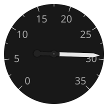
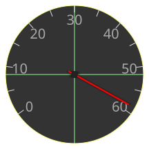
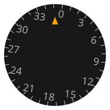
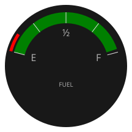
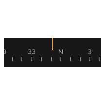
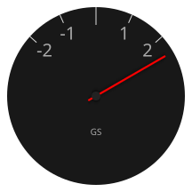
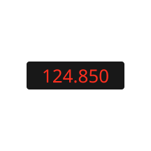
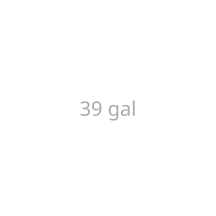

## Cookbook

Short recipes for common gauge-building problems.
See the [tutorial](TUTORIAL.md) to build a gauge step by step,
the [API reference](API.md) for details and the [gallery](CONTRIB.md) for complete gauges.

- [The pattern: factory, configure, render](#the-pattern-factory-configure-render)
- [Model a real gauge](#model-a-real-gauge)
- [Move the scale, not the pointer](#move-the-scale-not-the-pointer)
- [A sector that follows a metric](#a-sector-that-follows-a-metric)
- [A heading tape with no seam](#a-heading-tape-with-no-seam)
- [Custom units](#custom-units)
- [LCD and segmented text](#lcd-and-segmented-text)
- [Combine several metrics](#combine-several-metrics)
- [Further reading](#further-reading)

Each snippet defines a `gauge`; to see it, drop it into a page like this:

```html
<script src="https://d3js.org/d3.v7.min.js"></script>
<script src="https://unpkg.com/@patricksurry/g3/dist/g3-contrib.min.js"></script>
<script>
  /* snippet here */
  g3.panel().width(240).height(240).append(g3.put().x(120).y(120).append(gauge))('body');
</script>
```

Without a hub, the panel animates each gauge with its `.fake()` metrics.


### The pattern: factory, configure, render

Every G3 component is a factory that returns a renderer function.
Chained getter/setter methods configure the renderer, and calling it with
a target element draws it, in the style of D3's [reusable charts](https://bost.ocks.org/mike/chart/).
Usually the panel makes that final call for you.

```js
const gauge = g3.gauge()                        // factory returns a renderer
    .metric('rpm')                              // setters configure it, and return it for chaining
    .measure(d3.scaleLinear().domain([0, 3500]).range([-135, 135]))
    .fake(g3.forceSeries(500, 3000))
    .append(                                    // children are renderers too
        g3.gaugeFace(),
        g3.axisTicks().step(250).size(5),
        g3.axisTicks().step(500),
        g3.axisLabels().step(500).format(v => v / 100),
        g3.indicatePointer().shape('sword'),
    );
// gauge.metric() with no argument is a getter: 'rpm'
```

<p align='center'></p>


### Model a real gauge

Start from how the physical instrument works:
anything that moves is driven by a metric, and everything else is fixed decoration.
A pointer sweeping a fixed dial is an `indicatePointer` on a gauge with a `measure`.
A card turning behind a fixed mark is an [autoindicated](#move-the-scale-not-the-pointer) sub-gauge.
A drum or ball turning in a window is a sub-gauge of `kind('drum')` or `kind('ball')`,
like the wet compass (`nav.compass.wet`) in the [gallery](CONTRIB.md).
Nest a sub-gauge for each independent moving part, each with its own metric.

To match the original's proportions, trace over a photo.
Overlay a partially transparent image of the original on your gauge,
and add `g3.contrib.debug.alignment()`, whose crosshairs and circle mark the gauge's center and its 100-unit radius,
or turn on a background grid with `.grid(true)` on the gauge or panel.
Crop the photo to a square around the dial so it lines up with the circle,
then adjust angles and insets until the marks agree.
Remove the overlay when you're done.

Here the [tutorial](TUTORIAL.md#create-a-new-gauge)'s Jaguar E-type tachometer
traces over a photo of the original:

```js
const gauge = g3.gauge()
    .metric('engineRPM').unit('rpm')
    .measure(d3.scaleLinear().domain([0, 6000]).range([-125, 125]))
    .fake(g3.forceSeries(0, 6000))
    .append(
        g3.contrib.debug.alignment(),
        g3.put().scale(0.95).append(
            g3.axisTicks().step(500).style('stroke-width: 5'),
            g3.axisTicks().step(100).size(5),
            g3.axisLabels().step(1000).format(v => v / 100).inset(20).size(15),
            g3.indicatePointer(),
        ),
        // a photo of the real gauge, cropped square around the dial
        g3.element('image', {href: 'jagetach.jpg', x: -100, y: -100, width: 200, height: 200, opacity: 0.5}),
    );
```

<p align='center'></p>


### Move the scale, not the pointer

Many instruments hold the pointer still and move the card behind it,
like a heading indicator or the pressure window on an altimeter.
Set `.autoindicate(true)` and the gauge moves its whole contents to track the metric.

```js
const gauge = g3.gauge()
    .append(
        g3.gaugeFace(),
        g3.gauge()
            .metric('heading').unit('deg')
            .fake(g3.forceSeries(0, 360, {wrap: true}))
            .measure(d3.scaleLinear().domain([0, 360]).range([0, 360]))
            .autoindicate(true)                 // the card rotates by -heading
            .append(
                g3.axisTicks().step(10).size(8),
                g3.axisLabels().step(30).format(v => v / 10).inset(18),
            ),
        g3.element('path', {d: 'M 0,-75 l 6,15 l -12,0 z'}).class('g3-highlight-fill'),  // fixed lubber mark
    );
```

<p align='center'></p>


### A sector that follows a metric

An `axisSector` is fixed decoration, like a red arc marking low fuel.
To shade a range that moves, use `indicateSector`, which fills from a fixed `anchor` to the metric's current value,
like the bar on a modern fuel or battery gauge.
The anchor defaults to 0, so here the sector fills up from empty.

```js
const gauge = g3.gauge()
    .metric('fuelLevel')                        // fraction of a full tank
    .fake(g3.forceSeries(0, 1))
    .measure(d3.scaleLinear().domain([0, 1]).range([-75, 75]))
    .append(
        g3.gaugeFace(),
        g3.axisSector([0, 0.125]).inset(4).size(5).class('g3-danger-fill'),     // fixed low-fuel mark on the rim
        g3.indicateSector().inset(12).size(18).class('g3-normal-fill'),         // fills to the current level
        g3.axisTicks([0, 0.25, 0.5, 0.75, 1]).inset(12).size(18),
        g3.axisLabels({0: 'E', 0.5: '½', 1: 'F'}).inset(45).size(16),
        g3.gaugeLabel('FUEL').y(30),
    );
```

<p align='center'></p>

The sector can also follow a different metric than the rest of the gauge.
Nest it in a sub-gauge with its own `metric` and the same `measure`,
like the moving maximum-speed "barber pole" on a jet's airspeed indicator.


### A heading tape with no seam

A linear tape that scrolls with heading has a seam where 359° wraps to 0°.
Draw the tape twice, with the seam in different places, and cross-fade between them with `indicateStyle`
so the visible copy is always far from its seam.
Clip the result to a window.

```js
const label = d => d % 90 ? String(((d % 360) + 360) % 360 / 10) : 'NESW'.charAt(((d / 90 % 4) + 4) % 4);

function tape(rescale, trigger) {
    return g3.gauge()
        .metric('heading').unit('deg')
        .kind('linear').autoindicate(true)
        .rescale(rescale)
        .measure(d3.scaleLinear().domain([-360, 360]).range([-720, 720]))
        .append(
            g3.indicateStyle().trigger(trigger).append(
                g3.axisTicks().step(10).size(8),
                g3.axisLabels().step(30).format(label).inset(-12).size(14),
            ),
        );
}

const gauge = g3.gauge()
    .clip(g3.element('rect', {x: -100, y: -30, width: 200, height: 60}))
    .append(
        g3.element('rect', {x: -100, y: -30, width: 200, height: 60}).class('g3-bg-fill'),
        g3.put().y(10).append(
            // seam at 0/360, shown near 180
            tape(v => v, v => 1 - Math.abs(v - 180) / 180)
                .fake(g3.forceSeries(0, 360, {wrap: true})),
            // seam at 180, shown near 0
            tape(v => (v + 180) % 360 - 180, v => Math.abs(v - 180) / 180),
        ),
        g3.element('path', {d: 'M 0,-30 l 0,25'}).class('g3-highlight-stroke'),
    );
```

<p align='center'></p>

Both tapes read the same `heading` metric, so only one needs a `.fake()`.

If your tape is really a card wrapped around a drum, as on a wet compass, there is no seam to hide:
a `kind('drum')` gauge wraps its scale around a cylinder seen side-on.
The wet compasses `nav.compass.wet` and `nav.compass.wetTilting` in the [gallery](CONTRIB.md)
build the card on a drum and a ball.


### Custom units

You only need `.unit()` if a gauge should convert automatically from whatever units the hub reports,
using the units [convert-units](https://github.com/convert-units/convert-units) knows about.
For anything else, leave `.unit()` off and write the `measure` in the units your data arrives in.
For example, glideslope deviation is reported in dots, which convert-units has never heard of:

```js
// the hub reports glideslope deviation in dots, up to 2.5 either side
const gauge = g3.gauge()
    .metric('glideslope')                       // no .unit(): values are used as reported
    .fake(g3.forceSeries(-3, 3))
    .measure(d3.scaleLinear().domain([-2.5, 2.5]).range([-60, 60]))
    .append(
        g3.gaugeFace(),
        g3.axisTicks([-2, -1, 1, 2]).size(10),
        g3.axisTicks([0]).size(20),
        g3.axisLabels([-2, -1, 1, 2]).inset(22),
        g3.gaugeLabel('GS').y(40),
        g3.indicatePointer().clamp([-2.5, 2.5]),    // a stop at full deflection
    );
```

<p align='center'></p>

If the hub's values need more than a linear scale, transform them in an indicator's `.rescale()`,
or put a small shim in front of G3 that converts the metrics before the panel sees them.


### LCD and segmented text

G3 declares the [DSEG](https://www.keshikan.net/fonts-e.html) fonts as `DSEG7-Classic` and `DSEG14-Classic`.
Combine them with `indicateText` for radio and transponder displays.
The KT 76C transponder (`radionav.transponder.KT76C`) in the [gallery](CONTRIB.md) is a complete example.

```js
const gauge = g3.gauge()
    .metric('com1Frequency')
    .fake(g3.categoricalSeries([118.3, 121.5, 124.85]))
    .css('text.lcd {font-family: DSEG7-Classic; fill: #ff2e1f}')
    .append(
        g3.element('rect', {x: -70, y: -20, width: 140, height: 40, rx: 4}).class('g3-bg-fill'),
        g3.indicateText().format(v => v.toFixed(3)).size(26).class('lcd'),
    );
```

<p align='center'></p>


### Combine several metrics

Name extra metrics after the primary one.
The gauge redraws when any of them changes, and callbacks receive all current values as `metrics`,
followed by the unit of the primary metric.
Values in `metrics` are as reported by the hub, without unit conversion,
so leave `.unit()` off when you combine them, and show the hub's unit with `indicateUnit`.
Empty sub-gauges supply fake values for each metric, in gallons.

```js
const gauge = g3.gauge()
    .metric('fuelLeft', 'fuelRight')            // no .unit(): use whatever the hub reports
    .append(
        g3.gauge().metric('fuelLeft').unit('gal').fake(g3.forceSeries(10, 40)),
        g3.gauge().metric('fuelRight').unit('gal').fake(g3.forceSeries(10, 40)),
        g3.indicateText().format((_, metrics) => Math.round(metrics.fuelLeft + metrics.fuelRight)).size(30),
        g3.put().y(25).append(g3.indicateUnit().format(unit => unit.toUpperCase())),
    );
```

<p align='center'></p>

The first argument to `format` is the primary metric's value, converted to the gauge's unit if it has one,
so with a `.unit()` you can still combine it with others that the hub reports in the same unit.


### Further reading

- Bartosz Ciechanowski's [Mechanical Watch](https://ciechanow.ski/mechanical-watch/) shows how real gauge mechanisms move.
- [Human Factors and Gauge Design: A Literature Review](https://backend.production.deepblue-documents.lib.umich.edu/server/api/core/bitstreams/530e47e8-9f1d-46b8-8281-d68990d09d2c/content); the executive summary is a good start.
