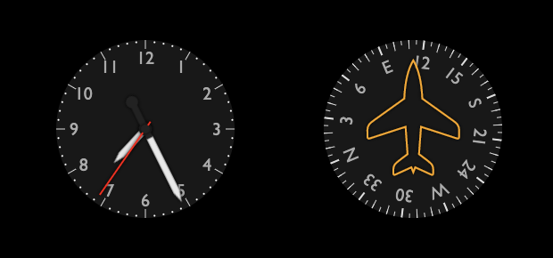
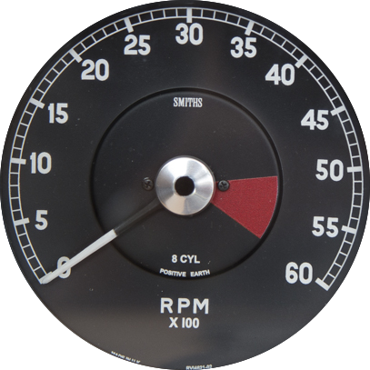
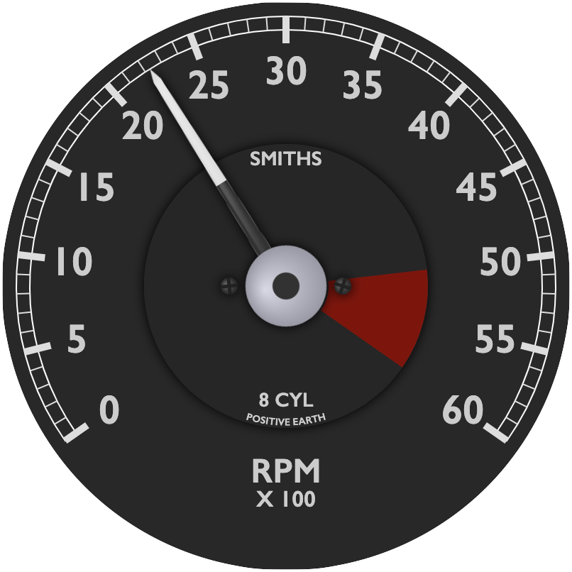
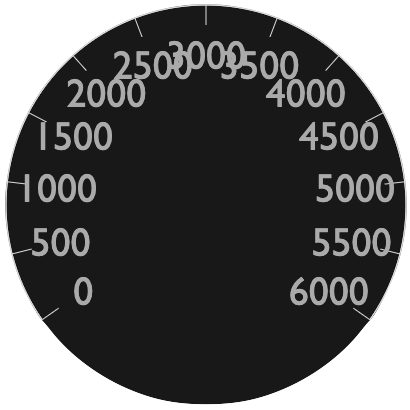
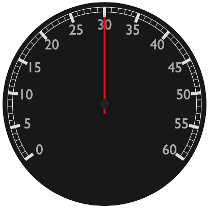

## Tutorial

Get started with G3: browse the existing gauges, assemble them into a panel,
feed it real metrics, and design a gauge of your own.
For short recipes see the [cookbook](COOKBOOK.md), and for details the [API reference](API.md).

### Browse existing gauges

Check things are working by creating a minimal HTML file to show a gallery
of all existing gauges, updated with fake metrics.
Create a new file called `gallery.html` that looks like this
(or use `../tutorial/gallery.html` for a slightly prettier version that includes the pointer gallery):

```html
<html>
    <body>
        <script src="https://unpkg.com/@patricksurry/g3/dist/g3-contrib.min.js"></script>
        <script>
g3.gallery.contrib('body');
        </script>
    </body>
</html>
```

This tells G3 to fetch the `g3.gallery.contrib` panel definition,
and draw it as an SVG object appended to the HTML `<body>` element.
By default the panel provides fake metrics so you'll see gauges moving
in a somewhat realistic but random way.
Save the file and use a terminal window to serve it locally using your favorite HTTP server.
For example try:
```shell
python -m http.server
```
or
```shell
npx http-server -p 8000
```
and then point your browser at http://localhost:8000/test.html.
You should see something that looks a bit like the [live demo](https://patricksurry.github.io/)
above.


### Define your own panel with existing gauges

The [contrib folder](../src/contrib)
included with `g3-contrib.js` is where all the predefined gauges live, including
clocks, flight instruments, as well as engine and electrical gauges.
Browse the auto-generated [Contributed Gauge Gallery](CONTRIB.md) for visual previews, metrics, and factory source code.
The full index of definitions can be found in [`__index__.ts`](../src/contrib/__index__.ts),
and two predefined panels, `g3.gallery.contrib` and `g3.gallery.pointers`,
will draw a gallery of all known gauges and indicator pointers respectively.

Let's create our own panel that shows a clock and a heading gauge side by side.
Create a new HTML file called `panel.html` (or copy `../tutorial/panel.html`):
```html
<html>
  <body>
    <script src="https://unpkg.com/@patricksurry/g3/dist/g3-contrib.min.js"></script>
    <script>
var panel = g3.panel()
    .width(600).height(300)
    .append(
        g3.put().x(150).y(150).append(g3.contrib.clocks.simple()),
        g3.put().x(450).y(150).append(g3.contrib.nav.heading.generic()),
    );
panel('body');
    </script>
  </body>
</html>
```

This defines a layout we've called `panel` which specifies
a 600x300 SVG container, and places two existing gauges
at (150,150) and (450,150) respectively,
with names referencing the definitions in `src/contrib/__index__.js`.
By convention gauges are drawn with a radius of 100 SVG units,
but you can scale via `put().scale(1.5)...` if you'd prefer a radius of 150.

Note that the panel specification in the `panel` variable is actually a
function that will draw the panel when we call it with a CSS selector
like `panel('body')`.
In this case the panel is appended directly to the HTML `<body>` element,
and will start polling for metric updates as soon as it's drawn.

Serve locally as before and browse to http://localhost:8000/panel.html
and you should see something like this:

<div align='center'>
    
</div>


### Display real metrics

We've built a panel, but by default it's displaying fake [metrics](API.md#metrics) 
that are generated in the browser.
G3 normally polls an external URL for metrics,
and expects a [JSON](https://www.json.org/json-en.html) response object containing the current metrics.
Unless we specify a polling interval,
it will check four times per second (an interval of 250ms).

Let's modify `panel.html`, replacing `panel('body');` with:

```js
...
panel.interval(500).url('/metrics')('body');
...
```

We'll need a server that provides the two metrics,
one for `heading` (in degrees) and one for `time` (as seconds since midnight).
The metric names can be found in the gauge definitions,
or check your browser's development console (e.g. cmd-shift-J in Chrome)
where you'll see output like this:

```
...
g3-contrib.min.js:1 Starting panel expecting metrics for: (2) ['time', 'heading']
...
```

We'll use python to serve both the metrics and the HTML for the panel.

- Install [Python](https://www.python.org/) 
    and [FastAPI](https://fastapi.tiangolo.com/#installation)
- Create a file called `metrics.py` containing the code below
- Make a subfolder called `panels` and copy your `panel.html` there
- In a terminal, start the server: `fastapi dev metrics.py`
- In your browser, navigate to http://localhost:8000/metrics and check
  that you see a json result
- Finally, navigate to http://localhost:8000/panels/panel.html to see your gauges!

```python
from fastapi import FastAPI
from fastapi.staticfiles import StaticFiles
from random import gauss
from datetime import datetime, timezone

heading = 0

app = FastAPI()

# Serve panel.html from the panels folder, preventing CORS issues
app.mount("/panels", StaticFiles(directory="panels"), name="panels")

# Provide the metrics endpoint
@app.get("/metrics")
async def metrics(latest: int = 0, units: bool = False):
    global heading
    # randomly vary the heading
    heading += gauss(0, 2)      

    # calculate time since midnight for the clock
    now = datetime.now(timezone.utc)
    seconds = (now - now.replace(hour=0, minute=0, second=0, microsecond=0)).total_seconds()

    return {
        "latest": 0,
        "units": {},
        "metrics": {
            "heading": heading,
            "time": seconds
        }
    }
```

In a more realistic scenario you probably want to fetch metrics
from a simulator like [SimConnect](https://github.com/odwdinc/Python-SimConnect)
for FS2020, or [XPlaneConnect](https://github.com/nasa/XPlaneConnect/)
for X-Plane.
The [G3 python server](https://github.com/patricksurry/g3py)
illustrates how this works.

**XPlane 11**

Let's hook up our flight panel to
[XPlane 11](https://www.x-plane.com/).
Once you've got XPlane installed (the demo version works fine),
install NASA's [XPlaneConnect plugin](https://github.com/nasa/XPlaneConnect).
Assuming you've already grabbed the
[G3 python server](https://github.com/patricksurry/g3py)
you can just modify `panel.html` to point at the demo XPlane endpoint:

```js
g3.panel().interval(250).url('/metrics/xplane.json')('body');
```

Now start up a flight in XPlane and open your panel in the browser as above.
You should see our flight panel mimicking the live XPlane display.
You can see how the server maps XPlane metrics via datarefs
in mapping.yml [here](https://github.com/patricksurry/g3py/tree/master/xplane).
It will even automatically convert between compatible units to match your gauges!

**Microsoft Flight Simulator (FS2020)**

TODO: include an example based on FS2020 SimConnnect


### Create a new gauge

The easiest way to get started with gauge design is to find a
similar gauge in `src/contrib`
and experiment with its
[implementation](https://github.com/patricksurry/g3/tree/master/src/contrib).
As a simple example of building a gauge from scratch, let's create a
[classic Jaguar E-type tachometer](https://www.smiths-instruments.co.uk/blog/new-smiths-digital-tachometer-for-the-classic-jaguar-e-type) (photo, below left).
With a few lines of code, we'll end up with a credible facsimile (below right).

<div align='center'>
    
    
</div>
<br />

Let's get started by creating a new HTML file called `jagetach.html`,
and build a skeleton for our gauge.  (Or copy `../tutorial/jagetach0.html`.)
We'll choose a name for the gauge, specify the external metric it should display
(with explicit units if possible), then define a measure which
translates the metric values to the scale on our gauge.
The trickiest part is to estimate the angular range of the tachometer scale.
We can guesstimate by eye (it looks like it occupies about 2/3 of the circle,
so a range of -120° to +120°), we could measure with a protractor,
or we can draw a line through the center point of the original image
and see what range of metric values span 180°.
In our example, 180° represents a range of about 43(00) RPM so we want a
total span of 60/43\*180 or about 250° in total, ranging from -125° to +125°.
After defining the measure, we'll add a default face (dark-shaded circle)
along with an axis line, ticks and labels, and then draw it to the screen.
Here's what we have so far (see result below left):

```html
<html>
  <body>
    <script src="https://d3js.org/d3.v7.min.js"></script>
    <script src="https://unpkg.com/@patricksurry/g3/dist/g3-contrib.min.js"></script>
    <script>

var g = g3.gauge()
    .metric('engineRPM').unit('rpm')
    .measure(d3.scaleLinear().domain([0,6000]).range([-125,125]))
    .append(
        g3.gaugeFace(),
        g3.axisLine(),
        g3.axisTicks(),
        g3.axisLabels(),
    );

var p = g3.panel()
    .width(640)
    .height(640)
    .append(
        g3.put().x(320).y(320).append(g)
    );

p('body');
    </script>
  </body>
</html>
```

<div align='center'>
    
    
</div>
<br />

Now let's scale the gauge to make it little larger in the panel,
and then inset and customize the axis marks to look a little more
like the original.  We'll also add a default pointer so we can
actually see our RPM measurement (result above right):

```js
    ...
    .append(
        g3.gaugeFace(),
        g3.put().scale(0.95).append(
            g3.axisSector().style('fill: none; stroke: white'),
            g3.axisTicks().step(500).style('stroke-width: 6'),
            g3.axisTicks().step(100).size(5),
            g3.axisLabels().inset(18).size(15).format(v => v/100),
            g3.indicatePointer(),
        ),

    ...

        g3.put().x(320).y(320).scale(2).append(g)
        ...
```

Finally, we'll add a few labels and customize the pointer to look closer to the source,
though the fonts and logo could certainly use more love (result top right of this section).
You can find the final result in `../tutorial/jagetach2.html`.
The custom pointer is probably the fiddliest part,
but is not too bad with a basic understanding of
[SVG paths](https://developer.mozilla.org/en-US/docs/Web/SVG/Tutorial/Paths).
It's also possible to extract path definitions using a text editor,
either from existing SVG images or files created via
an SVG drawing tool like [Inkscape](https://inkscape.org/).

```js
var g = g3.gauge()
    .metric('engineRPM').unit('rpm')
    .measure(d3.scaleLinear().domain([0,6000]).range([-125,125]))
    .css(`
text.g3-gauge-label, .g3-axis-labels text {
    font-stretch: normal;
    font-weight: 600;
    fill: #ccc;
}
.g3-gauge-face { fill: #282828 }
`)
    .append(
        g3.gaugeFace(),
        g3.gaugeFace().r(50).style('filter: url(#dropShadow2)'),
        g3.axisSector([5000,6000]).inset(50).size(35).style('fill: #800'),
        g3.gaugeLabel('SMITHS').y(-45).size(7),
        g3.gaugeLabel('8 CYL').y(40).size(7),
        // a trick to put a circular path label opposite the 3000RPM top of the gauge
        g3.put().rotate(180).append(
            g3.axisLabels({3000: 'POSITIVE EARTH'}).orient('counterclockwise').size(3.5).inset(52)
        ),
        g3.gaugeLabel('RPM').y(65).size(12),
        g3.gaugeLabel('X 100').y(75).size(8),
        g3.gaugeScrew().shape('phillips').r(3).x(-20),
        g3.gaugeScrew().shape('phillips').r(3).x(20),
        g3.put().scale(0.95).append(
            g3.axisSector().style('fill: none; stroke: white'),
            g3.axisTicks().step(500).style('stroke-width: 5'),
            g3.axisTicks().step(100).size(5),
            g3.axisLabels().inset(20).size(15).format(v => v/100),
            g3.indicatePointer().append(
                // the full pointer blade
                g3.element('path', {d: 'M 3,0 l -1.5,-90 l -1.5,-5 l -1.5,5 l -1.5,90 z'})
                    .style('fill: #ddd'),
                // the bottom half of the pointer, drawn over the full blade
                g3.element('path', {d: 'M 3,0 l -0.75,-45 l -4.5,0 l -0.75,45 z'})
                    .style('fill: #333'),
                // a blurred highlight on the blade to give a bit of 3D effect
                g3.element('path', {d: 'M -1,0 l 0,-90 l 2,0 z'})
                    .style('fill: white; filter: url(#gaussianBlur1); opacity: 0.5'),
                // the central hub, with a highlight
                g3.element('circle', {r: 15}).style('fill: #ccd'),
                g3.element('circle', {r: 15}).class('g3-highlight'),
                // the central pin
                g3.element('circle', {r: 5}).style('fill: #333'),
            ),
        ),
    );
```

If you're obsessed with matching your original gauge "perfectly",
a helpful trick is to temporarily overlay a high quality, partially transparent image of the original
(or half the original) on top of your gauge.
For example, modify your panel to look like:

```js
var p = g3.panel().width(640).height(640).append(
    g3.put().x(320).y(320).scale(2).append(
        g,
        g3.element('image', {href: 'original.png', x: -100, y: -100, width: 200, opacity: 0.3})
    )
);
```

The cookbook recipe [Model a real gauge](COOKBOOK.md#model-a-real-gauge) adds an alignment gauge
to help line up the overlay.

### Define a new metric

In this tutorial we reused the `engineRPM` metric defined with the
[sample engine gauges](https://github.com/patricksurry/g3/blob/master/src/contrib/jagetype.ts),
but it's easy to add our own.
Simply choose a name for the metric that matches how it will be provided from the external source,
and (if desired) define a corresponding [fake metric](API.md#metrics) for testing.
Note it's often a good idea to test metric values outside the expected range
(e.g. max of 7000 instead of the max label of 6000)
to ensure your gauge behaves as expected.  For our tachometer we probably
want to [clamp](API.md#g3-indicatePointer) the pointer as if there was a physical stop at 6000:

```js
var g = g3.gauge()
    .metric('jaguarRPM').unit('rpm')
    .fake(g3.forceSeries(0, 7000))
    ...
    .append(
        ...
        g3.put().scale(0.95).append(
            ...
            g3.indicatePointer().clamp([0,6000]).append(
                ...
```

**Extra credit** If you want to explore further, try modifying the tachometer to add
a sub-gauge in the bottom quadrant which shows a simple clock with hours and minutes.
